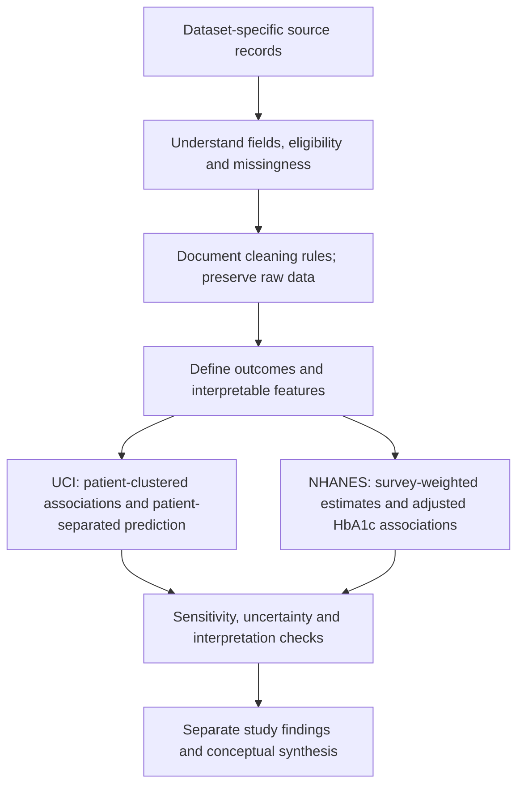
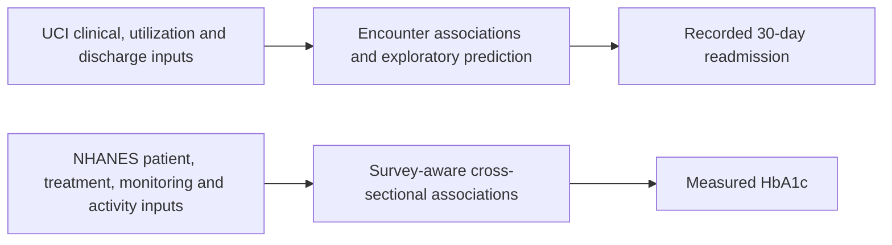

# Chronic Disease Management

## Problem Statement

Diabetes management spans clinical treatment, monitoring, healthcare access, and transitions after
hospitalization. Available records capture only parts of this process. This project examines which
recorded patient and care-related characteristics are associated with measurable outcomes, while
distinguishing useful predictors from unmeasured mechanisms and unsupported causal claims.

Two complementary observational studies address the question:

1. **UCI:** Which clinical, treatment, utilization, and discharge variables are associated with recorded
   30-day readmission, and which help predict it at discharge?
2. **NHANES:** Which socioeconomic, activity, treatment, and monitoring characteristics are associated
   with measured HbA1c among adults reporting diagnosed diabetes?

Readmission and HbA1c are different outcomes. Neither alone proves poor disease management.

## Datasets and Rationale

| Dataset | Why it was used | Analysis population | Outcome |
| --- | --- | --- | --- |
| UCI Diabetes 130-US Hospitals, 1999-2008 | Real hospital encounters with readmission labels, clinical records, and prior utilization | 99,343 eligible encounters from 69,990 patients; original file has 101,766 encounters | Recorded readmission within 30 days |
| NHANES 2017-2018 | Measured HbA1c plus examination, activity, socioeconomic, and diabetes-monitoring information | 804-person measured-HbA1c domain within a 9,254-person survey universe; initial adjusted model uses 651 complete cases | Continuous HbA1c; secondary >=8% and >=7% flags |

UCI supplies a hospital-outcome perspective but lacks direct lifestyle and adherence measures.
NHANES adds management context and a laboratory endpoint; it is cross-sectional and does not track
comparable 30-day readmission. The selected NHANES cycle contains the required monitoring fields in
one complete pre-pandemic cycle; it was not chosen as the newest or largest available dataset.

The datasets contain different people, periods, and sampling schemes. They are analyzed separately:
**no patient-level merge, pooled estimate, or external validation of UCI using NHANES is performed.**

## Analytical Workflow



## Features and Methods

| Study | Main feature groups | Methods and safeguards |
| --- | --- | --- |
| UCI | Prior inpatient/emergency/outpatient visits; diagnoses and diagnosis count; age; stay duration; medication burden and insulin; admission/discharge, payer, and specialty context | Adjusted logistic regression with patient-clustered uncertainty; fixed expanded logistic/gradient-boosting comparisons; patient-separated evaluation; patient bootstrap and permutation importance |
| NHANES | Age/recorded sex; BMI; income-to-poverty ratio; treatment; usual diabetes professional; A1C monitoring; unit-aware glucose checks; activity summaries | MEC weights with strata/PSUs; full-design domain inference; Taylor uncertainty; fixed Gaussian HbA1c regression; complete-case accounting and alternative specifications |

UCI adds 15 derived columns to its cleaned cohort. NHANES adds 27 derived columns, including category,
quality, domain-related outcome, and monitoring representations. Not every stored column is a predictor.
IDs, outcomes, survey-design fields, and redundant source/derived versions are kept separate from clinical predictor sets.

NHANES education and other categories support descriptive comparisons but are not all included in the
initial ten-slope model. Unknown responses remain distinct from justified zeros. No study measures complete medication adherence.

## Major Findings

### UCI: Readmission

- Eligible early-readmission rate: **11.39%**.
- Readmission rate with no prior inpatient visits: **8.59%**; with two or more: **22.02%**.
- Each additional prior inpatient visit has adjusted OR **1.309** (95% CI **1.292-1.327**): higher odds, not an equivalent increase in probability.
- Prior inpatient use and discharge disposition lead both expanded models' tested predictive rankings.
- Gradient boosting achieves exploratory held-out **ROC-AUC 0.668** and **average precision 0.226**; prediction remains modest.
- The medication-change association is sensitive to analytical choices and is not a proven protective effect.

### NHANES: Glycemic Status

- Survey-weighted mean HbA1c: **7.28%**, with 95% interval **7.12%-7.44%**.
- Weighted HbA1c >=8% share: **23.18%**, with interval **19.51%-27.32%**.
- Reported insulin/pill use retains positive adjusted HbA1c associations across tested Gaussian scenarios; this does not establish medication harm.
- Age and income directions are consistent, but multiple-testing-adjusted evidence is specification-sensitive.
- The initial model excludes **153** domain members for predictor missingness and has only **five residual survey degrees of freedom**.

Weighted NHANES estimates describe the selected measured domain without additional item-nonresponse
adjustment. They are not universal clinical targets or fully corrected estimates for all adults with diabetes.
NHANES has no held-out predictive ranking; its association coefficients cannot be compared directly with UCI odds ratios or importance scores.

## Input, Channel, and Output



These are analytical mappings. Illness burden, continuity, adherence, and care transitions are possible
clinical pathways, not demonstrated mediators. Reported monitoring/activity gives partial behavioral
information; neither study establishes that changing a particular input will improve its outcome.

## Conclusions and Limitations

Hospital history and discharge context provide useful readmission-associated information in UCI.
NHANES offers a separate survey-aware picture of measured HbA1c and recorded treatment/management context.
Together they broaden the research perspective but do not validate a shared mechanism or intervention.

The project is complete as an **exploratory observational analysis**. Major limitations include historical
hospital data, outcome capture, cross-sectional directionality, unmeasured confounding, nonresponse,
complete-case selection, top coding, and limited survey design information. Sensitivity checks do not remove these limitations.

External/prospective evaluation, clinical utility, calibrated action thresholds, and intervention effectiveness
remain future work. No deployable patient risk score or causal treatment recommendation is validated.

## Research Findings

Start with [the combined research synthesis](reports/research_synthesis/README.md) for the project question,
side-by-side study designs, important findings, input-channel-output framework, and limits of comparison.
The studies are complementary, not linked participant data or external validation of one another.

## Repository Organization

```text
Chronic-Disease-Management/
  datasets/
    uci/
      data/raw/           Original CSVs; unchanged
      data/processed/     Cleaned and feature CSVs
      scripts/            Five computational stages and method tests
      reports/            CSV/JSON results, plots, Markdown snapshots
      reference/          Original project presentation PDF
      run_pipeline.py     UCI workflow
      requirements*.txt   Environment dependencies
      README.md           UCI instructions
    nhanes/               Completed survey-aware study and maintained final report
  reports/
    research_synthesis/   Cross-dataset conceptual synthesis
  requirements.txt        Shared dependency entry point
```

- [UCI instructions](datasets/uci/README.md)
- [Research findings](datasets/uci/reports/06_final_report/README.md)
- [NHANES study and roadmap](datasets/nhanes/README.md)
- [NHANES initial audit](datasets/nhanes/reports/01_data_audit/README.md)
- [NHANES fields explained](datasets/nhanes/FIELD_GUIDE.md)
- [NHANES cleaning results](datasets/nhanes/reports/02_data_cleaning/README.md)
- [NHANES features](datasets/nhanes/reports/03_feature_extraction/README.md)
- [NHANES weighted analysis](datasets/nhanes/reports/04_outcome_analysis/README.md)
- [NHANES robustness checks](datasets/nhanes/reports/05_robustness_validation/README.md)
- [NHANES final research report](datasets/nhanes/reports/06_final_report/README.md)

## Shared Python Environment

Use the repository-level [requirements.txt](requirements.txt) to install dependencies for both studies:

```powershell
python -m pip install -r requirements.txt
```

This file includes the two dataset-specific requirement files rather than duplicating their package lists.
They remain available for smaller dataset-only installations. The shared environment installs the union
of both sets; it does not merge datasets or outcomes. The UCI exact lock remains a snapshot of its verified
Windows setup, not a separately verified repo-wide or WSL lock.


## Run the Analyses

From this repository root, using the interpreter containing the dependencies:

```powershell
python datasets/uci/run_pipeline.py
python datasets/nhanes/scripts/00_data_acquisition/download_data.py
python datasets/nhanes/scripts/01_data_audit/data_audit.py
python datasets/nhanes/scripts/02_data_cleaning/data_cleaning.py
python datasets/nhanes/scripts/03_feature_extraction/feature_extraction.py
python datasets/nhanes/scripts/04_outcome_analysis/outcome_analysis.py
python datasets/nhanes/scripts/05_robustness_validation/robustness_validation.py
```

The workflows update tabular outputs and plots, not Markdown reports. Reports are maintained snapshots.
Raw and large derived patient-level files are Git-ignored but remain local. Restore raw CSVs from UCI
when setting up a clone.
NHANES is now populated with its own scripts, sources, and reports. Its raw data must be downloaded with
the acquisition script after cloning. It studies measured HbA1c, not the UCI readmission outcome;
the two participant datasets must not be merged.