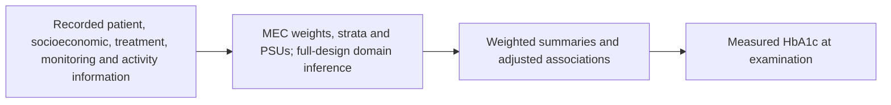

# NHANES Diabetes Management Study

## Research Question

Start with [the plain-language field guide](FIELD_GUIDE.md) to understand the participant rows, codes,
questionnaire skips, survey fields, and frequency units before cleaning.

Which recorded socioeconomic, physical-activity, treatment, and monitoring characteristics are
associated with measured HbA1c among adults reporting diagnosed diabetes?
This is a separate cross-sectional study, not a validation of the UCI readmission model.
Participants cannot be linked between these datasets.

Read [the final NHANES research report](reports/06_final_report/README.md) for the findings and
[the project comparison](../../reports/research_synthesis/README.md) for its relationship to UCI.

## Dataset Choice and Population

Use **NHANES 2017-2018**, a complete pre-pandemic cycle with measured HbA1c and detailed
diabetes-monitoring questions. This choice prioritizes a coherent initial workflow, not recency or
maximum sample size. Pooling other cycles requires checking variable comparability and weight rules.

The primary domain includes adults aged 20+, DIQ010=1 (reported doctor-diagnosed diabetes),
measured HbA1c, positive MEC weights, and observed stratum/PSU. Known pregnancy (RIDEXPRG=1) is excluded.
It does not reliably separate type 1 and type 2 diabetes. Borderline responses are not diagnosed diabetes.
Pregnancy status is only released for women 20-44; blanks outside that group are not universally unknown status.
Two retained participants have pregnancy status 3 (cannot ascertain). They remain in the primary domain;
a separate cleaning-stage sensitivity flag excludes them.

The primary outcome is **continuous measured HbA1c (LBXGH, percent)**.
HbA1c >=8% is an exploratory secondary cutoff, with >=7% used in sensitivity analysis, not a
universal individualized treatment goal or proof of management failure. Missing HbA1c is never recoded as normal.

The six acquired modules provide demographics/design, diagnosed diabetes and care, measured HbA1c,
body measurements, activity, and healthcare access/utilization. The full universe has 9,254 participants;
the measured-HbA1c domain has 804, and the initial adjusted model uses 651 complete cases.

## Features and Analysis

| Group | Main fields/representations |
| --- | --- |
| Demographics/body size | Age and adult groups, recorded sex, measured BMI and bands |
| Socioeconomic | Income-to-poverty ratio and education categories |
| Treatment | Reported insulin and diabetic pill use |
| Monitoring/access | Usual diabetes professional, past-year A1C testing, glucose-check frequency with units |
| Activity | Five weekly activity domains, MET/equivalent-minute summaries, sedentary hours |
| Outcomes/design | Measured HbA1c and secondary flags; MEC weights, strata and PSUs used for inference, not clinical predictors |

49 selected fields and three domain/status flags form the 52-column cleaned table. Adding 27 derived
columns produces 79 stored columns, not 79 independent predictors. The initial adjusted model has
ten fixed slopes; education and other categories support descriptions but are not all adjusted model terms.

Methods include full-design Taylor survey estimates, Gaussian HbA1c associations, explicit complete-case
accounting, FDR adjustment, and seven fixed alternative specifications. Predictive importance and holdout
performance have not been estimated for NHANES.

## Major Findings

- Weighted mean HbA1c: **7.28%**, with survey 95% interval **7.12%-7.44%**.
- Weighted HbA1c >=8% share: **23.18%**, with interval **19.51%-27.32%**.
- The initial model uses **651 complete cases**, excluding **153** domain members for predictor missingness, and has **five residual survey degrees of freedom**.
- Insulin-use and pill-use associations remain positive across Gaussian sensitivities, but do not establish medication harm or benefit.
- Age and income directions remain negative; their FDR-adjusted evidence depends on specification.
- Weighted HbA1c differs descriptively between original complete cases (**7.24%**) and excluded domain members (**7.46%**); this is not a formal group test.

These weighted estimates describe the measured domain without additional item-nonresponse correction.
They must not be presented as fully adjusted estimates for every adult with diabetes or individualized treatment goals.

## Study Diagram



Monitoring and activity are reported behaviors. Adherence and care quality are not fully measured,
and cross-sectional associations do not establish a causal management channel.

## Conclusion

NHANES complements the hospital study with measured glycemic status and reported management context.
The work supports survey-aware exploratory associations, not causal treatment recommendations or a validated
prediction system. Nonresponse, complete-case selection, top coding, and limited design degrees of freedom
remain important limitations. External validation and clinical utility remain future research.

## Organization

```text
nhanes/
  data/raw/2017-2018/              Six original CDC SAS transport files
  data/processed/                 Merged, cleaned, response-reason and feature CSVs
  reference/2017-2018/             Downloaded official component codebooks
  scripts/00_data_acquisition/    Validated download and one-to-one merging
  scripts/01_data_audit/          Cohort, variable, and missingness audit
  scripts/02_data_cleaning/       Variable-specific rules and regression tests
  scripts/03_feature_extraction/ Unit-aware features and regression tests
  scripts/04_outcome_analysis/   Full-design weighted estimates and regression
  scripts/05_robustness_validation/ Fixed model/cohort/threshold sensitivity checks
  reports/00_data_acquisition/    Source inventory, join audit, file fingerprints
  reports/01_data_audit/          Audit tables and maintained explanation
  reports/02_data_cleaning/       Cleaning decisions, response counts, and rules
  reports/03_feature_extraction/ Feature dictionary, coverage, and summaries
  reports/04_outcome_analysis/   Weighted outcomes, coefficients, and plots
  reports/05_robustness_validation/ Sensitivity estimates and missingness descriptions
  reports/06_final_report/       Maintained research synthesis; no Python generator
  requirements.txt               Acquisition, features, and survey-analysis dependencies
```

The exploratory workflow and final research synthesis are complete. Further research remains separate;
there are no report-only Python generators. Markdown documents are maintained separately from tabular outputs.

## Run the Current Steps

From this NHANES folder, using an environment containing the listed dependencies:
For a shared environment, install the [repo-level requirements](../../requirements.txt) from the repository root.
The local file below remains available for NHANES-only acquisition/audit work.

```powershell
python -m pip install -r requirements.txt
python scripts/00_data_acquisition/download_data.py
python scripts/01_data_audit/data_audit.py
python scripts/02_data_cleaning/data_cleaning.py
python scripts/03_feature_extraction/feature_extraction.py
python scripts/04_outcome_analysis/outcome_analysis.py
python scripts/05_robustness_validation/robustness_validation.py
python -m unittest discover -s scripts/00_data_acquisition -p test_acquisition.py -v
python -m unittest discover -s scripts/02_data_cleaning -p test_cleaning.py -v
python -m unittest discover -s scripts/03_feature_extraction -p test_features.py -v
python -m unittest discover -s scripts/04_outcome_analysis -p test_survey_analysis.py -v
python -m unittest discover -s scripts/05_robustness_validation -p test_robustness.py -v
```

Acquisition downloads from CDC only when a raw/component-codebook file is absent.
Existing raw files are parsed and checked, not overwritten. HTML masquerading as a SAS file fails parsing.
The merged CSV and audit tables are regenerated; the original files are retained and their hashes recorded.
The initial environment tested is Python 3.13.14 on Windows with pandas 2.2.3 and NumPy 2.5.1.
The acquisition parser corrects a verified exact SAS-zero reader artifact without changing source XPT files.
Component restoration counts are recorded in source_inventory.csv. Cleaning exports selected fields for
all 9,254 participants, a primary-domain flag, and a separate response-reason table.

## Roadmap

| Step | Status | Work |
| --- | --- | --- |
| 0. Acquire and join | Complete | Download official components; validate SEQN; left join to demographics |
| 1. Audit | Complete | Inspect eligibility, missingness, special codes, survey design, and provisional cohort |
| 2. Clean | Complete | Variable-specific codes, skip reasons, validated units, preserved survey design, primary/sensitivity domain flags |
| 3. Extract features | Complete | 27 derived fields; unit-aware monitoring, complete activity quantities, categories, and secondary targets |
| 4. Analyze | Complete (initial) | svy Taylor estimates and complete-case Gaussian HbA1c associations; explicit design and missingness accounting |
| 5. Check robustness | Complete (associations) | Seven alternatives for model/cohort/threshold choices; response coverage and complete-case composition; prediction not performed |
| 6. Synthesize | Complete | Maintained standalone findings and conceptual UCI comparison; no patient-level merge or report-only Python script |

## Survey Design Is Essential

For these lab/questionnaire combinations use **WTMEC2YR**, with **SDMVSTRA and SDMVPSU together**.
PSU labels repeat across strata. Interview weights alone are not appropriate for the HbA1c domain.
Retain the full demographic universe for design-based domain/subpopulation variance estimation rather
than assuming the 804-person subset is an independent simple random sample.
Survey weights alone in an ordinary regression do not automatically provide valid complex-survey uncertainty.
Evaluate HbA1c nonresponse, small-domain precision, and any need for additional response adjustments.

Initial survey-weighted estimates and an adjusted model are now available. They use MEC weights and
Taylor variance through the maintained svy library, with full-universe `where` domain selection.
They do not apply additional HbA1c item-nonresponse adjustment. The model uses 651 complete cases and
has only five residual survey degrees of freedom; stronger population or causal claims are not justified.

## Meaning of the Input-Channel-Output Framework

- **Inputs:** demographics, socioeconomic measures, activity, body size, treatment, and recorded care access.
- **Observed channel information:** self-reported monitoring and usual care; more direct than UCI proxies, but not measured adherence.
- **Output:** measured HbA1c at the examination, not later hospital readmission.

All measurements are cross-sectional. Severity can influence treatment and monitoring; reverse causation and
confounding prevent causal treatment-effect claims. Actual dietary intake, insurance, and smoking components
are not downloaded in this first pass; do not present them as measured predictors.

## Evidence and Sources

- [Initial audit findings](reports/01_data_audit/README.md)
- [Cleaning decisions and results](reports/02_data_cleaning/README.md)
- [Feature definitions and results](reports/03_feature_extraction/README.md)
- [Survey-aware outcome analysis](reports/04_outcome_analysis/README.md)
- [Robustness findings](reports/05_robustness_validation/README.md)
- [Final research synthesis](reports/06_final_report/README.md)
- [Official source inventory](reports/00_data_acquisition/source_inventory.csv)
- [Variable dictionary](reports/01_data_audit/variable_dictionary.csv)
- [NHANES analysis tutorial](https://wwwn.cdc.gov/nchs/nhanes/tutorials/)
- [Survey demographic codebook](https://wwwn.cdc.gov/Nchs/Data/Nhanes/Public/2017/DataFiles/DEMO_J.htm)
- [Measured HbA1c codebook](https://wwwn.cdc.gov/Nchs/Data/Nhanes/Public/2017/DataFiles/GHB_J.htm)

Raw and merged patient-level data are Git-ignored by the repository rules; restore/download them before running a fresh clone.