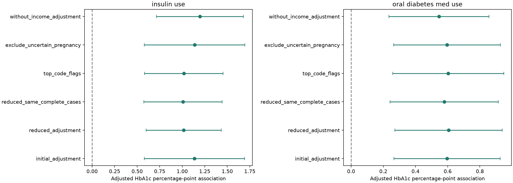
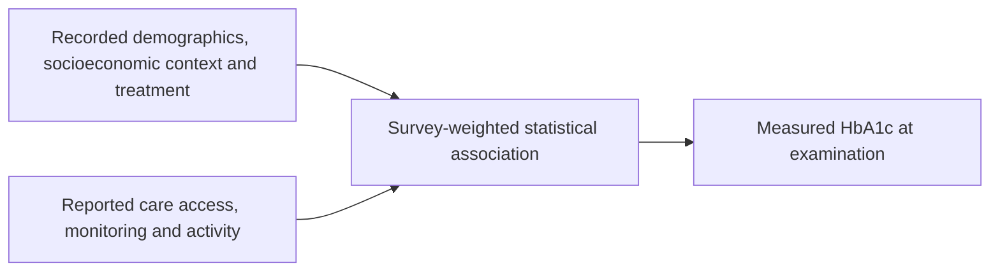

# NHANES Diabetes Management: Research Findings

## Research Question

Which recorded socioeconomic, physical-activity, treatment, and monitoring characteristics are
associated with measured HbA1c among adults reporting diagnosed diabetes?

This is an exploratory cross-sectional study of NHANES 2017-2018, not a study of later readmission,
a causal treatment evaluation, or an externally validated prediction system.

## Executive Summary

The primary measured-HbA1c domain contains **804 participants**. Its survey-weighted mean HbA1c is
**7.28% (95% interval 7.12% to 7.44%)**, and the weighted share at or above 8% is
**23.18% (19.51% to 27.32%)**. These estimates use MEC examination weights and Taylor survey uncertainty.

The initial adjusted model has **651 complete cases** and only **five residual survey degrees of freedom**.
Reported insulin and diabetic-pill use have positive adjusted HbA1c associations across the tested
Gaussian specifications. These are markers of recorded treatment context, not evidence that medication worsens control.
Age and income associations retain negative directions but their multiple-testing-adjusted evidence is less consistent.

Missingness, top coding, limited design information, and unmeasured disease severity/duration constrain inference.
The analysis supports exploratory understanding of recorded management factors, not treatment changes or clinical deployment.

## Data and Cohort

Six official components were joined by unique participant ID SEQN: demographics/design, diabetes,
measured HbA1c, body measurements, physical activity, and healthcare utilization/access.
The merged file has 9,254 people and 145 original variables, with no UCI participant records included.

| Selection | Participants |
| --- | ---: |
| Full demographic survey universe | 9,254 |
| Adults aged 20+ | 5,569 |
| Reported doctor-diagnosed diabetes (DIQ010=1) | 876 |
| Primary measured-HbA1c domain | 804 |
| Primary domain excluding two uncertain pregnancy statuses | 802 |
| Original adjusted-model complete cases | 651 |

The primary domain excludes known pregnancy, requires measured HbA1c, a positive MEC weight, and
available strata/PSUs. Diagnosed diabetes is self-reported and does not reliably separate type 1 and type 2.
Of the 876 diagnosed adults, 40 lack positive MEC weights and 32 further examined adults lack HbA1c.
No missing outcome is assigned a normal result.

All 9,254 people remain in cleaned and feature data so survey-domain variance estimation can retain
the full design. The study uses domain flags, not a prematurely filtered survey file.

## Cleaning and Features

Clean 49 selected original fields and retain explicit response reasons. Separate valid observations,
refusal, Don't know, structural skips, age/release restrictions, unavailable measurements, top codes,
and missing frequency units. Preserve genuine zeros; no blanket blank-to-zero or clinical imputation is applied.
An exact SAS zero-reader artifact was verified against original numeric bytes and corrected at acquisition;
the downloaded XPT files were not altered.

Add 27 derived columns, producing a 79-column feature table. They include:

- Glucose-check frequency converted using documented daily/weekly/monthly/yearly units.
- Five weekly activity quantities and complete-data total/MET/equivalent-minute summaries.
- Treatment, monitoring, and usual-care indicators.
- Adult age/BMI, education, and income-to-poverty categories.
- Secondary HbA1c >=8% and >=7% outcome flags, distinct from predictors.

792 domain members have sufficient data for complete activity quantities; 12 remain missing.
The column count is not a count of independent predictors. IDs, survey design, outcome shortcuts,
domain/quality flags, and overlapping source/derived representations must not be used indiscriminately.

## Statistical Methods

Use the maintained svy library with WTMEC2YR, SDMVSTRA, and SDMVPSU. The full design contains
15 strata and 30 stratum-PSU pairs. `where` selects analysis/model domains without prefiltering the design.
Means use Taylor-linearized uncertainty and survey t intervals; cutoff proportions use logit intervals.

Fit a fixed Gaussian/identity association model with ten slopes: age/10, recorded female category,
BMI/5, income-to-poverty ratio, insulin use, pill use, usual diabetes professional, past-year A1C test,
log(1 + daily-equivalent glucose checks), and log(1 + weekly equivalent activity minutes).
No outcome-driven predictor selection or learned imputation is performed.

Apply Benjamini-Hochberg FDR to the ten coefficient tests, excluding the intercept.
Confidence intervals are individual, not multiple-comparison-adjusted. The complete-case model excludes
153 domain members for at least one missing predictor; counts of missing variables overlap.

## Weighted Outcomes

| Outcome | Weighted estimate | Survey 95% interval |
| --- | ---: | --- |
| Mean HbA1c | 7.28% | 7.12% to 7.44% |
| HbA1c >=8% | 23.18% | 19.51% to 27.32% |
| HbA1c >=7% | 49.62% | 41.96% to 57.30% |

The unweighted HbA1c mean is 7.40%; weighting changes representation rather than changing measurements.
Cutoffs are analytical comparisons, not universal individualized treatment goals or proof of management failure.
No additional HbA1c item-nonresponse adjustment is applied, so interpretation for every adult with diabetes remains limited.

## Adjusted Associations

| Initial-model term | HbA1c percentage-point coefficient | Individual survey 95% interval | FDR-adjusted p |
| --- | ---: | --- | ---: |
| Insulin use versus no use | 1.136 | 0.579 to 1.693 | 0.028 |
| Diabetic pill use versus no use | 0.595 | 0.266 to 0.925 | 0.028 |
| Income-to-poverty ratio, per unit | -0.130 | -0.242 to -0.018 | 0.102 |
| Age, per ten recorded years | -0.173 | -0.336 to -0.010 | 0.103 |
| Past-year A1C test versus no test | -0.258 | -0.724 to 0.208 | 0.356 |

These are adjusted differences in HbA1c percentage points, not odds ratios or percentage changes in probability.
The intercept is not a clinically meaningful baseline value. Top-coded age/income enter numerically in the initial specification.

Treatment selection, greater illness burden, diabetes duration, and reverse causation can explain positive
treatment associations. They do not justify stopping or changing medication. Inconclusive monitoring or
activity coefficients do not prove that monitoring or exercise has no benefit.

NHANES currently has no held-out predictive ranking; statistical evidence and differently scaled coefficients
must not be presented as a universal list of the most clinically important inputs.

## Robustness and Missingness

Seven fixed alternatives examine reduced adjustment, the same reduced model on the original complete cases,
top-code flags, pregnancy uncertainty, omission of income, and two secondary logistic cutoff outcomes.

Across the reference and five Gaussian alternatives, insulin-use coefficients range from 1.008 to 1.196
percentage points and pill-use coefficients from 0.546 to 0.605. Both retain positive directions and
within-model FDR evidence in all six fits. Age and poverty-ratio directions are stable but FDR evidence
is below 0.05 in only two of six and two of five applicable fits, respectively.

The reduced model has 683 complete cases and nine residual survey degrees of freedom; the original
has 651 and five. Holding the original sample fixed helps distinguish adjustment changes from sample changes.
Omitting income increases completeness to 737 but removes socioeconomic adjustment, not missingness bias.
Sensitivity models are correlated exploratory checks, not independent confirmations or p-value-based model selection.

Among 836 eligible examined diagnosed adults, weighted HbA1c response coverage is 97.65%
(96.49% to 98.82%). Coverage is descriptive, not a correction or evidence of a missing-at-random mechanism.
Original complete cases have weighted mean HbA1c 7.24% versus 7.46% among excluded domain members.
These composition comparisons are not formal significance tests, and available sample sizes vary by field.

## Input, Channel, and Output

This is the analytical connection. Clinical pathways through care continuity, adherence, treatment response,
and lifestyle remain hypotheses. Monitoring/activity are reported behaviors, not complete adherence measurements.
No temporal mediation analysis establishes that these inputs caused the measured outcome.

## Limitations and Conclusion

- Cross-sectional measurements do not establish temporal direction or treatment effects.
- Survey design correction does not remove unmeasured confounding or solve item nonresponse.
- The complete-case model is selected and has little residual design information for uncertainty.
- HbA1c thresholds, top-coded ages/incomes, and activity conversions are explicit analytical choices.
- Diet, smoking, and insurance modules were not acquired; do not claim they were adjusted predictors.
- Subgroup descriptions are not fairness assessments. No predictive/external/prospective validation or clinical utility is established.

The study provides a survey-aware description of measured HbA1c and exploratory associations with
recorded treatment and management context. Treatment-group differences are consistent within the tested
choices, while socioeconomic and age evidence is more specification-sensitive. The results warrant
careful further research, not causal or personalized clinical recommendations.

## Evidence and Next Research

- [Acquisition and source inventory](../00_data_acquisition/source_inventory.csv)
- [Audit](../01_data_audit/README.md), [cleaning](../02_data_cleaning/README.md), [features](../03_feature_extraction/README.md)
- [Weighted analysis](../04_outcome_analysis/README.md) and [robustness](../05_robustness_validation/README.md)
- [Coefficient CSV](../04_outcome_analysis/adjusted_hba1c_coefficients.csv)
- [Weighted outcome CSV](../04_outcome_analysis/weighted_outcomes.csv)
- [Sensitivity CSV](../05_robustness_validation/sensitivity_coefficients.csv)
- [Joint project synthesis](../../../../reports/research_synthesis/README.md)

Further work includes explicit nonresponse assumptions/adjustments, additional cycles, broader clinical
adjustment, nonlinear specifications, and a separate evaluation plan if prediction is attempted.
This report is a maintained snapshot of saved outputs; no report-only Python generator is retained.