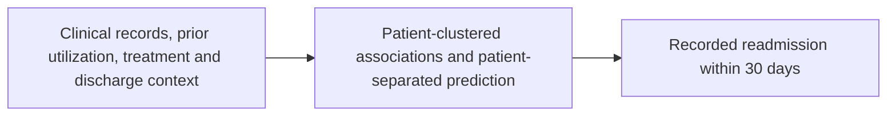

# UCI Diabetes Hospital Readmission Analysis

## Study Objective

Identify demographic, clinical, treatment, and prior healthcare-utilization factors
associated with recorded 30-day readmission among patients with diabetes.
Readmission is the observed outcome, not proof of poor disease management.

## Dataset and Rationale

Use the UCI Diabetes 130-US Hospitals dataset (1999-2008) because it provides recorded readmission
labels alongside clinical, treatment, discharge, and historical utilization information. The original
file contains 101,766 encounters and 50 columns. The primary cohort contains 99,343 encounters from
69,990 patients after the documented expired/hospice exclusions. Repeated encounters are retained.

It supports discharge-time readmission analysis, not direct measurement of adherence or lifestyle.
The hospital population and recorded-return outcome limit generalization beyond this study.

## Features and Analysis

| Group | Examples |
| --- | --- |
| Utilization | Prior inpatient, emergency, and outpatient visits; derived visit summaries |
| Clinical | ICD-9 diagnosis groups, diagnosis count, stay duration, procedures |
| Treatment | Inpatient medication counts/bands, insulin status, general and explicit dose-change indicators |
| Patient/care context | Age groups, race, admission/discharge categories, payer and medical specialty |

The cleaned cohort has 47 columns, and 15 derived columns produce a 62-column feature table.
Expanded predictive models use 22 selected inputs, not all stored columns. Identifiers and outcome labels
are excluded from predictors; redundant versions are not treated as independent evidence.

Methods include patient-clustered adjusted logistic inference, patient-separated model evaluation,
whole-patient bootstrap intervals, permutation importance, and fixed cohort/model sensitivities.

## Major Findings

- Early readmission occurs in **11.39%** of primary-cohort encounters.
- Rates are **8.59%** with no prior inpatient visits versus **22.02%** with two or more.
- Prior inpatient visits have adjusted OR **1.309** per visit (95% CI **1.292-1.327**), describing odds rather than probability.
- Prior inpatient use and discharge disposition rank highest in both expanded models among tested predictors.
- Gradient boosting has exploratory held-out ROC-AUC **0.668** and average precision **0.226**; discrimination remains modest.
- Medication-change evidence is not consistent across sensitivity choices and does not establish protection.

## Study Diagram



Care continuity and disease instability are possible connecting mechanisms, not demonstrated pathways.
Discharge disposition is a recorded destination/care-setting category, not a measurement of follow-up quality.

## Conclusion

Prior hospital utilization and discharge context support exploratory readmission risk research.
The findings do not prove preventability, treatment effects, or clinical deployment readiness.
NHANES provides a separate HbA1c study, not external validation of this model; see the
[project synthesis](../../reports/research_synthesis/README.md).

## Start Here

Read the [final research report](reports/06_final_report/README.md) for the findings,
clinical context, input-channel-output framework, and limitations.
Read the [PDF verification](reports/pdf_review/README.md) for the numerical and interpretive comparison.
This entire folder is UCI-specific; NHANES work belongs in the separate sibling dataset folder.

Run the full workflow with the interpreter where dependencies are installed:

```powershell
python run_pipeline.py
```

The runner checks dependencies, runs seven method regression tests, then executes
all five computational stages in order using the same Python interpreter. It stops on failure,
checks that both original CSV files are unchanged, and records the run in
[pipeline_run.json](reports/pipeline_run.json). A full run regenerates derived
datasets and reports in their existing output folders. It does not install packages,
modify raw data, create commits, or fetch additional datasets.

Report-only Python generators and the `--report-only` mode have been removed.
Markdown reports are maintained snapshots and must be reviewed manually after analytical changes.
If any stage fails, inspect the error and run record rather than assuming older reports are current.

## Environment Setup

The verified environment is **Python 3.13.14 on Windows**. Audit, cleaning, and feature
extraction use the standard library. Modeling and method tests
use the scientific packages listed in [requirements.txt](requirements.txt).

For a separate project environment, use Python 3.13 and install the exact recorded
project dependency versions from [requirements-lock.txt](requirements-lock.txt):

```powershell
python -m venv .venv
.\.venv\Scripts\python.exe -m pip install -r requirements-lock.txt
.\.venv\Scripts\python.exe run_pipeline.py
```

Activation is not required, so these commands avoid PowerShell activation-policy issues.
Use `requirements.txt` only when deliberately resolving newer compatible versions;
verify tests and numerical outputs again after dependency changes. The lock covers
project dependencies, not unrelated system packages. It records the validated
Windows/Python environment and does not guarantee identical installation or floating-point
results on every operating system or Python version.

## Project Organization

```text
uci/
  scripts/
    01_data_audit/
      data_audit.py                           Dataset inspection
    02_data_cleaning/
      data_cleaning.py                        Cohort selection and cleaning
    03_feature_extraction/
      feature_extraction.py                   Derived analytical variables
    04_outcome_analysis/
      outcome_analysis.py                     Run the analysis stage
      descriptive_analysis.py                 Rates and exploratory tests
      adjusted_model.py                       Clustered regression and evaluation
    05_robustness_validation/
      robustness_validation.py                Run robustness and importance checks
      prediction_models.py                    Fixed model comparison
      uncertainty_importance.py               Bootstrap, permutation, and subgroups
      sensitivity_analysis.py                 Alternative cohort and adjustment choices
      test_validation.py                      Focused regression checks
  reports/
    01_data_audit/
      README.md                               Start here for audit findings
      column_audit.csv                        Variable-level quality checks
      numeric_summary.csv                     Numeric distributions
      audit_summary.json                      Detailed machine-readable results
    02_data_cleaning/
      README.md                               Cleaning decisions and results
      cleaning_changes.csv                    Changed columns and record counts
      cleaning_summary.json                   Detailed cleaning results
    03_feature_extraction/
      README.md                               Feature definitions and interpretation
      feature_dictionary.csv                  Derived variables and source fields
      feature_value_counts.csv                Feature frequencies
      feature_summary.json                    Dimensions and input fingerprint
    04_outcome_analysis/
      README.md                               Findings, methods, and limitations
      readmission_rates.csv                   Category rates and clustered intervals
      adjusted_odds_ratios.csv                Adjusted associations and uncertainty
      analysis_summary.json                   Model, split, versions, and metrics
      *.csv, *.png, model_summary.txt          Other tables, plots, and technical results
    05_robustness_validation/
      README.md                               Robustness findings and interpretation
      model_comparison.csv                    Held-out model performance
      predictive_importance.csv               Model-specific predictor importance
      sensitivity_odds_ratios.csv             Alternative adjusted estimates
      *.csv, *.json, *.png                     Uncertainty, subgroups, and other results
    06_final_report/
      README.md                               Consolidated research findings
      report_sources.json                     Evidence file fingerprints
    pipeline_run.json                         Latest workflow execution record
  data/
    raw/
      diabetic_data.csv                       Original encounter records
      IDS_mapping.csv                         Original administrative code mappings
    processed/
      diabetes_cleaned.csv                    Separate cleaned study cohort
      diabetes_features.csv                   Cleaned fields plus derived features
  README.md                                   This workflow guide
  run_pipeline.py                             Single-command workflow runner
  requirements.txt                            Scientific Python dependencies
  requirements-lock.txt                       Exact validated project dependency versions
  reference/                                  Original presentation PDF
```

Each numbered folder represents one analytical step. Additional scripts will be
added within a step only when needed. Later report folders and derived-data folders
will be created when their corresponding steps are implemented.

## Step 1: Understand and Audit the Data

**Status: implemented.**

1. Load the original CSV while preserving category labels and ICD-9 code strings.
2. Check encounter counts, patient counts, duplicate rows, and repeated patients.
3. Measure missing values and inspect constant and invalid categories.
4. Summarize numeric variables and check administrative code mappings.
5. Describe a provisional cohort excluding expired and hospice discharge categories.
6. Save readable findings and detailed tables without modifying the source data.

Run from the project folder with Python 3.10 or later; no third-party packages are needed:

```powershell
python scripts/01_data_audit/data_audit.py
```

Read [the audit report](reports/01_data_audit/README.md) before opening the detailed tables.
Running the script updates only the step's generated reports.

## Step 2: Clean the Data

**Status: implemented.**

1. Exclude expired/hospice discharges using the documented study-scope rule.
2. Drop mostly missing weight and the constant drug columns `examide` and `citoglipton`.
3. Label missing and invalid categorical information as `Unknown`, including unavailable administrative codes.
4. Preserve lab `None` categories, ICD-9 strings, identifiers, and original outcomes.
5. Retain repeated encounters and extreme utilization counts; validate numeric values.
6. Check cohort integrity and export a separate cleaned dataset and decision log.

```powershell
python scripts/02_data_cleaning/data_cleaning.py
```

Read [the cleaning report](reports/02_data_cleaning/README.md) for decisions, before/after counts,
and guidance on loading the [cleaned dataset](data/processed/diabetes_cleaned.csv).
The script reads the original dataset directly; the audit does not need to be rerun first.
It overwrites only its own generated cleaned data and reports.

## Step 3: Extract Features

**Status: implemented.**

1. Define the binary target: 1 for recorded readmission within 30 days, otherwise 0.
2. Calculate total prior visits and prior acute-care visits.
3. Group inpatient medication counts as Low (0-5), Moderate (6-14), or High (15+).
4. Group each recorded diagnosis into Diabetes, Circulatory, Respiratory, Other, or Unknown.
5. Derive general regimen-change and explicit drug dose-change indicators separately.
6. Count active diabetes drug fields and create insulin, medication, and test-recorded indicators.
7. Combine recorded age bands without inventing exact ages.
8. Preserve the cleaned fields and save the derived feature table and dictionary.

```powershell
python scripts/03_feature_extraction/feature_extraction.py
```

Run data cleaning first. Read [the feature report](reports/03_feature_extraction/README.md)
for definitions, frequencies, and modeling guardrails. The [feature table](data/processed/diabetes_features.csv)
retains both original and derived variables; these are not all independent predictors.
Inpatient medication counts are not necessarily long-term outpatient polypharmacy.

## Step 4: Analyze Outcomes and Important Variables

**Status: initial analysis implemented.**

1. Compare full-cohort readmission rates using patient-clustered uncertainty intervals.
2. Summarize count distributions by outcome.
3. Run exploratory chi-square and Mann-Whitney tests on one random encounter per patient.
4. Flag sparse tables and adjust exploratory p-values for multiple comparisons.
5. Fit a prespecified adjusted logistic regression with patient-clustered standard errors.
6. Report adjusted odds ratios and whole-term tests rather than assuming associations are causes.
7. Train a separate version of the model using approximately 80% of patients; evaluate on the remaining patients.
8. Report ROC-AUC, average precision, probability errors, illustrative precision/recall, and calibration.

Install the dependencies, then run feature extraction before this stage:

```powershell
python -m pip install -r requirements.txt
python scripts/04_outcome_analysis/outcome_analysis.py
```

Read [the outcome-analysis report](reports/04_outcome_analysis/README.md) for results and interpretation.
The script saves tables and plots separately without changing the data files.
Encounter/patient identifiers and the original outcome are excluded from predictors.
Fixed category definitions avoid fitting preprocessing on held-out patients.

This step identifies adjusted associations rather than predictive importance. Step 5 subsequently
adds nonlinear model comparison, alternative adjustments/cohorts, subgroup summaries,
patient-bootstrap metric uncertainty, and permutation rankings. External validation remains unperformed.
No clinical intervention or deployment claim follows from these findings.

## Step 5: Check Robustness and Predictive Importance

**Status: implemented; results are exploratory.**

1. Retain the patient-separated split and original held-out predictions from Step 4.
2. Compare fixed regularized logistic and histogram-gradient-boosting models using the same 22 predictors.
3. Fit scaling and category encoding on training patients only; exclude identifiers and outcomes from predictors.
4. Bootstrap whole evaluation patients 200 times to calculate metric intervals and paired model differences.
5. Permute each input five times to measure model-specific importance; jointly permute related input groups as well.
6. Report subgroup metrics with sparse-group flags, without interpreting them as evidence of fairness.
7. Check one encounter per patient, log-transformed utilization, expanded adjustment, and hospice inclusion.
8. Keep the original data and all previous results unchanged; write a separate validation report.

```powershell
python scripts/05_robustness_validation/robustness_validation.py
python -m unittest discover -s scripts/05_robustness_validation -p test_validation.py -v
```

Run Steps 1-4 first and install the dependencies. Read [the robustness report](reports/05_robustness_validation/README.md)
for model comparisons, important inputs, sensitivity findings, and limitations.
The tests check patient bootstrap behavior, paired comparisons, sparse groups, predictor boundaries,
training-only preprocessing, and held-out encounter alignment.

The evaluation set has already been examined in Step 4, so this is not a fresh final test.
Bootstrap intervals are conditional on the fitted models. Permutation variability is not a confidence interval.
No external validation, repeated-split model stability, clinical utility, or deployable thresholds are established.

## Final Synthesis Snapshot

**Status: completed document; no Python generator is retained.**

1. Verify that cleaning, feature, and analysis cohort counts agree.
2. Check that the validation evidence refers to unchanged inputs and the same patient split.
3. Summarize descriptive rates, adjusted associations, predictive importance, and sensitivity findings.
4. Interpret the clinical meaning of leading predictors without claiming treatment effects.
5. Separate the observed analytical input-output relationship from unmeasured clinical mechanisms.
6. Record every evidence file used to generate the synthesis.

The [final report](reports/06_final_report/README.md) is a maintained snapshot of the verified results.
[report_sources.json](reports/06_final_report/report_sources.json) records its evidence fingerprints.
Changes to preceding data or analysis require rerunning the affected stages and manually reviewing the report.

## Project Completion and Future Work

The local exploratory study is complete: data audit, cleaning, feature extraction,
adjusted association analysis, predictive importance, robustness checks, final synthesis,
and a recorded end-to-end workflow are available.

Independent external validation, repeated-split predictive stability, prospective
clinical assessment, and action-threshold selection remain future research. They are
not prerequisites for presenting this as an exploratory study, but they are necessary
before stronger generalization or clinical-use claims. No independent readmission-validation dataset
or clinical intervention evaluation has been used for this UCI study.

## Input, Channel, and Output

- **Inputs:** patient demographics, recorded diagnoses, labs, inpatient treatment, and prior utilization.
- **Channel:** hypothesized disease burden and care patterns; adherence and continuity are not directly measured.
- **Output:** recorded readmission within 30 days.

The initial prediction setting is discharge-time assessment. Variables measured
during the stay must not be treated as available at admission.