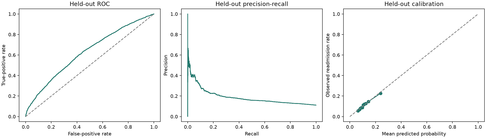

# Step 4: Outcome Analysis

## Study Population and Outcome

Analyzed **99,343 encounters** from **69,990 patients**.
Recorded early readmission occurred in **11,314 encounters (11.39%)**.
The outcome is readmission recorded within 30 days, not demonstrated poor diabetes management.

## How the Analysis Was Performed

1. Summarize full-cohort readmission rates by patient, treatment, diagnosis, and utilization categories.
2. Calculate approximate 95% rate intervals using patient-clustered standard errors, not independent-encounter assumptions.
3. Select one encounter per patient at random (seed 42): **69,990 encounters** for exploratory tests.
4. Apply chi-square tests to categorical variables and Mann-Whitney U tests to count distributions.
5. Withhold chi-square p-values when expected cell counts are below five; adjust the remaining exploratory p-values with Benjamini-Hochberg FDR.
6. Fit a prespecified logistic regression to all encounters, with standard errors clustered by patient.
7. Test complete model terms using clustered Wald tests; apply a separate FDR adjustment to that family of tests.
8. Fit the same model on training patients only and evaluate on held-out patients.

Full-cohort descriptive rates and one-encounter-per-patient tests describe different samples.
Rate intervals use a large-sample approximation; very small or all-zero/all-one groups have no interval reported.
Mann-Whitney tests compare distributions and are not automatically tests of median differences.

## Adjusted Model Specification

```text
readmitted_30d ~ number_inpatient + number_emergency + number_outpatient + num_medications + number_diagnoses + time_in_hospital + C(age_group, Treatment(reference="Under 40")) + C(race, Treatment(reference="Caucasian")) + C(diag_1_group, Treatment(reference="Other")) + C(insulin, Treatment(reference="No")) + C(A1Cresult, Treatment(reference="None")) + medication_changed
```

Continuous counts enter linearly on the log-odds scale. This is an exploratory assumption, not a verified dose-response relationship.
References: age Under 40, race Caucasian, diagnosis Other, insulin No, HbA1c None, and no medication change.
Race is included as an observed demographic/social-context variable, not a biological explanation or a recommendation for treatment allocation.
Gender is summarized descriptively but omitted from this initial model because its unknown category has only three encounters.
Other unmeasured and omitted factors may confound associations. This specification does not adjust for every possible factor.
Model converged: **True**. McFadden pseudo-R-squared: **0.0368**.
Pseudo-R-squared is not the percentage of outcome variance explained.

## Adjusted Count and Treatment Associations

| Predictor | Adjusted odds ratio | Patient-clustered 95% CI | Clustered p-value |
| --- | ---: | --- | ---: |
| number_inpatient | 1.309 | 1.292 to 1.327 | <1e-300 (below numerical precision) |
| number_emergency | 1.035 | 1.009 to 1.061 | 0.00765 |
| number_outpatient | 0.996 | 0.981 to 1.011 | 0.59 |
| num_medications | 1.004 | 1.001 to 1.007 | 0.00369 |
| number_diagnoses | 1.048 | 1.036 to 1.061 | 2.42e-14 |
| time_in_hospital | 1.023 | 1.016 to 1.031 | 6.85e-10 |
| medication_changed | 0.941 | 0.891 to 0.994 | 0.0299 |

An odds ratio above 1 means higher adjusted odds; below 1 means lower adjusted odds.
For count predictors this is per additional recorded unit. It is not an equivalent percentage change in probability.
Medication-change estimates are associations, not proof of protection or a treatment effect.
Effect sizes for differently scaled variables cannot be compared as a universal importance ranking.

## Whole-Term Evidence

These tests assess whether a model term contributes an adjusted association, not its predictive importance.
FDR-adjusted p-values below 0.05 are exploratory evidence after accounting for this family of comparisons.

| Model term | FDR-adjusted clustered p-value |
| --- | ---: |
| number_inpatient | <1e-300 (below numerical precision) |
| C(age_group, Treatment(reference="Under 40")) | 4.74e-15 |
| number_diagnoses | 9.67e-14 |
| C(insulin, Treatment(reference="No")) | 1.47e-10 |
| C(diag_1_group, Treatment(reference="Other")) | 5.09e-10 |
| time_in_hospital | 1.37e-09 |
| C(A1Cresult, Treatment(reference="None")) | 0.00033 |
| num_medications | 0.00553 |
| number_emergency | 0.0102 |
| medication_changed | 0.0359 |
| C(race, Treatment(reference="Caucasian")) | 0.284 |
| number_outpatient | 0.59 |

## Held-Out Patient Evaluation

Training: **79,522 encounters / 55,992 patients**.
Test: **19,821 encounters / 13,998 patients**.
Patient overlap: **0**. Held-out prevalence: **11.13%**.
The split assigns about 20% of patients to evaluation, not necessarily 20% of encounters.
Categories use fixed documented domains; no outcome-informed feature selection or threshold tuning is performed.
The full-cohort association model is separate from the training-only model used to generate test predictions.

| Metric | Result | Interpretation |
| --- | ---: | --- |
| ROC-AUC | 0.626 | Ranking discrimination; 0.5 is chance |
| Average precision | 0.189 | Precision-recall summary; compare with test prevalence 0.111 |
| Brier score | 0.0965 | Probability error; lower is better |
| Constant-risk baseline Brier | 0.0990 | Baseline predicts training prevalence for every test encounter |
| Log loss | 0.3385 | Probability error penalizing confident mistakes; lower is better |

| Illustrative probability threshold | Precision | Recall |
| --- | ---: | ---: |
| 0.20 | 0.269 | 0.125 |
| 0.50 | 0.500 | 0.016 |

Thresholds 0.20 and 0.50 are fixed illustrations, not optimized or clinically validated action thresholds.
Test metrics and calibration are encounter-weighted point estimates from a single split; they do not have patient-bootstrap uncertainty intervals.
This is internal evaluation, not external validation, temporal validation, or evidence of deployment readiness.

## Plots




## Detailed Outputs

- [readmission_rates.csv](readmission_rates.csv): category sizes, rates, and clustered intervals.
- [numeric_comparisons.csv](numeric_comparisons.csv): full-cohort count distributions by outcome.
- [exploratory_tests.csv](exploratory_tests.csv): tests using one encounter per patient and FDR adjustment.
- [adjusted_odds_ratios.csv](adjusted_odds_ratios.csv): every parameter, including categorical contrasts and clustered intervals.
- [adjusted_term_tests.csv](adjusted_term_tests.csv): clustered whole-term tests and FDR-adjusted p-values.
- [model_summary.txt](model_summary.txt): technical regression summary.
- [held_out_predictions.csv](held_out_predictions.csv): test encounter identifiers, outcomes, and predictions.
- [calibration.csv](calibration.csv): observed and predicted probabilities by quantile-based bins.
- [analysis_summary.json](analysis_summary.json): specification, versions, source fingerprint, split sizes, and metrics.

## Input, Channel, and Output

Inputs are recorded utilization, demographics, diagnoses, and inpatient treatment/testing.
The connecting channel is hypothesized disease burden and care patterns, only partially observed through proxies.
The output is recorded early readmission. Adherence, lifestyle, care continuity, and intervention effects cannot be established here.

## Remaining Work

Investigate nonlinear count effects, alternative clinical adjustment sets, subgroup performance,
patient-bootstrap metric uncertainty, and robustness across cohort definitions before operational recommendations.
A predictive-importance comparison with additional models has not been performed.
