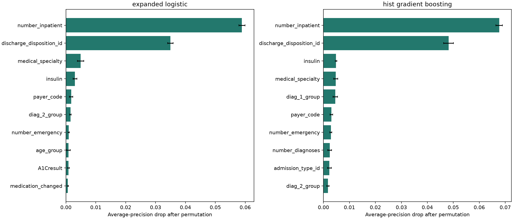
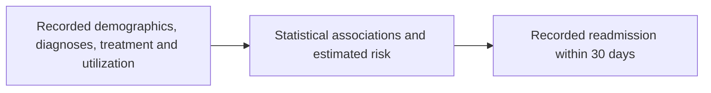
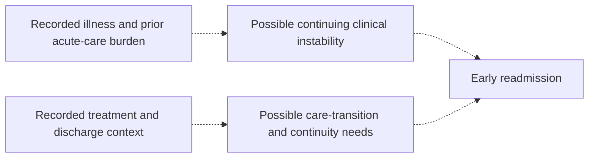

# Diabetes Hospital Readmission: Research Findings

## Research Question

Which recorded patient, clinical, treatment, and prior healthcare-utilization factors are associated with
30-day hospital readmission among patients with diabetes, and which help predict this outcome?

## Executive Summary

The primary study includes **99,343 encounters** with **11,314 early readmissions (11.39%)**.
Prior inpatient visits and discharge disposition are the leading tested predictive inputs across both expanded models.
Prior inpatient use remains positively associated with early readmission across sensitivity analyses.
Medication-change evidence is less consistent, and overall predictive performance remains modest.
These are observational and exploratory findings, not proof of poor disease management or validated treatment effects.

## Study Design and Methods

This is an exploratory observational study of the UCI Diabetes 130-US Hospitals dataset (1999-2008).
The analytical unit is a hospital encounter. Patients may contribute multiple encounters.
The prediction setting is discharge-time assessment, not diagnosis prediction or admission-time triage.

| Data stage | Encounters | Columns |
| --- | ---: | ---: |
| Original dataset | 101,766 | 50 |
| Cleaned study cohort | 99,343 | 47 |
| Feature table | 99,343 | 62 |

The original data contain **71,518 unique patients**; the primary cohort contains **69,990**.
Exclude **2,423 encounters** with expired/hospice discharge codes 11, 13, 14, 19, 20, and 21.
Hospice exclusion defines study scope; it does not mean those patients are inherently unable to return.

### Cleaning and Feature Decisions

- Preserve the raw CSVs. Export cleaned data and features separately.
- Drop weight (96.86% missing) and the constant drug columns examide and citoglipton.
- Represent missing/invalid categorical information as Unknown; do not fabricate weight or laboratory measurements.
- Preserve lab None categories as no result recorded, not normal results.
- Retain repeated patients, extreme utilization counts, identifiers for grouping, and original ICD-9 strings.
- Add 15 target, utilization, diagnosis, age, medication, and testing variables.
- Distinguish a general medication-regimen change from explicit drug Up/Down dose changes.
- Define readmitted_30d as 1 for <30, and 0 for >30 or NO. Neither outcome label is a predictor.

### Statistical and Predictive Analysis

Describe full-cohort rates with patient-clustered intervals. Use one seed-42 randomly selected encounter per patient
for exploratory chi-square and Mann-Whitney tests, withholding unreliable sparse-table p-values.
Fit a prespecified adjusted logistic regression with patient-clustered standard errors and whole-term Wald tests.
Apply Benjamini-Hochberg FDR adjustments separately to exploratory tests and adjusted term tests.
Compare the initial model with expanded regularized logistic regression and histogram gradient boosting.
The expanded models share 22 predictors, fit preprocessing on training patients only, and use fixed settings.
Bootstrap whole held-out patients 200 times and permute predictors five times per model.
Check one encounter per patient, nonlinear utilization, expanded adjustment, and hospice inclusion.

## Main Findings

### Prior Inpatient Use

| Recorded prior inpatient visits | Encounters | Early-readmission rate |
| --- | ---: | ---: |
| 0 | 66,245 | 8.59% |
| 1 | 18,984 | 13.25% |
| 2+ | 14,114 | 22.02% |

Each additional recorded prior inpatient visit is associated with adjusted odds ratio **1.309**
(patient-clustered 95% CI **1.292 to 1.327**).
This is approximately **30.9% higher adjusted odds**, not the same percentage increase in probability.
The association retains its direction across the tested model and cohort assumptions.
Prior hospital use can reflect accumulated illness burden and acute-care reliance; it does not directly measure adherence.

### Predictive Inputs

| Model | Five leading predictors by average-precision permutation drop |
| --- | --- |
| expanded_logistic | number_inpatient, discharge_disposition_id, medical_specialty, insulin, payer_code |
| hist_gradient_boosting | number_inpatient, discharge_disposition_id, insulin, medical_specialty, diag_1_group |

Prior inpatient use and discharge disposition lead both rankings. Rankings are model-specific and limited to the 22 tested inputs.
- **Discharge disposition:** records destination/care setting at discharge. It can proxy dependency or care needs, not verified follow-up quality.
- **Medical specialty and payer:** may reflect referral patterns, case mix, access, and documentation. They are not direct measures of social circumstances.
- **Insulin status:** records treatment during the encounter and may reflect severity or clinician selection; insulin is not shown to cause readmission.
- **Diagnoses and diagnosis count:** summarize recorded morbidity/billing burden, not a validated severity or comorbidity score.
- **Length of stay:** can reflect severity, treatment course, and care logistics; a longer stay is not proven harmful.
- **Medication count:** describes medications administered during the encounter, not necessarily long-term outpatient polypharmacy.
- **Age and lab categories:** supply context, but their smaller permutation effects do not prove clinical irrelevance.

### Medication-Change Evidence Is Not Robust

The primary model shows lower adjusted odds with the general change flag, while crude rates are higher in changed encounters.
This illustrates how case mix and adjustment affect an association; neither comparison establishes a treatment effect.
With one encounter per patient or expanded adjustment, its 95% interval includes odds ratio 1.
Therefore, the analysis does not support a confident protective-effect claim. Reduced precision is not proof of no effect either.

| Sensitivity scenario | Medication-change adjusted OR | 95% interval |
| --- | ---: | --- |
| baseline_adjustment | 0.941 | 0.891 to 0.994 |
| one_encounter_per_patient | 0.996 | 0.925 to 1.073 |
| log_utilization | 0.940 | 0.890 to 0.994 |
| expanded_adjustment | 0.950 | 0.899 to 1.004 |
| hospice_included_deaths_excluded | 0.942 | 0.892 to 0.995 |

### Predictive Performance

| Model | ROC-AUC | Average precision | Brier score |
| --- | ---: | ---: | ---: |
| initial_logistic | 0.626 | 0.189 | 0.0965 |
| constant_risk_baseline | 0.500 | 0.111 | 0.0990 |
| expanded_logistic | 0.657 | 0.213 | 0.0951 |
| hist_gradient_boosting | 0.668 | 0.226 | 0.0942 |

Gradient-boosting ROC-AUC has patient-bootstrap 95% interval **0.654 to 0.681**.
The expanded models improve discrimination relative to the initial model, but absolute performance remains modest.
Average precision must be compared with held-out prevalence, not interpreted as overall accuracy.
The same holdout was examined in earlier analysis, so these are exploratory internal comparisons, not untouched final evaluation.

## Input, Channel, and Output

### Observed Analytical Link

The model is an analytical mapping from inputs to an outcome, not a biological or clinical mechanism.
All features are defined for discharge-time assessment; inpatient information must not be treated as available at admission.

### Hypothesized Clinical Pathways

Dashed arrows indicate hypotheses, not demonstrated pathways. Adherence, diet, outpatient continuity,
and post-discharge monitoring are not directly measured, and no mediation analysis establishes the care channel.

## Practical Interpretation

Prior hospital use and discharge-care context are reasonable candidates for further review in future monitoring studies.
Case-management outreach, medication reconciliation, and coordinated follow-up are possible interventions to evaluate,
not interventions shown by this dataset to reduce readmission. No fixed timing protocol or risk threshold is validated.
A decision-support system would require prospective evaluation, clinical oversight, workload/cost analysis, and subgroup safeguards.

## Limitations

- Historical hospital records from 1999-2008 may not represent current treatment and discharge practice.
- Recorded readmission is not necessarily diabetes-related relapse, avoidable admission, or management failure; planned returns may contribute.
- No recorded return does not establish absence of readmission at another institution; this is not a complete national follow-up record.
- The released flat file has no hospital identifier or usable calendar timestamps for hospital-separated or temporal validation.
- Missingness, diagnosis grouping, encounter selection, and cohort exclusions influence the population and interpretation.
- Clustered inference addresses within-patient dependence, not unmeasured confounding or hospital-level dependence.
- Associations, predictive importance, and differences in treatment groups do not identify causal effects.
- Correlated predictors and implausible permuted combinations limit importance interpretation; shuffle SD is not a confidence interval.
- Bootstrap intervals condition on fixed fitted models and do not include training or model-selection variability.
- Subgroup point estimates do not establish fairness; no external validation, clinical utility, or deployable thresholds are established.

## Conclusion

Recorded prior inpatient utilization is a consistent readmission-associated factor and the leading tested predictive input.
Discharge disposition adds substantial model-specific predictive information, with diagnoses, treatment, and documentation
providing further context. The medication-change association is sensitive to analytical choices.
The findings support exploratory risk stratification research, not causal or clinical deployment claims.

## Future Research

1. Assess model stability across additional patient-separated splits or grouped cross-validation.
2. Seek independent clinical data for external evaluation after harmonizing cohorts, variables, and readmission definitions.
3. Evaluate thresholds, calibration, costs, workload, subgroup uncertainty, and prospective clinical outcomes before deployment.
4. Study adherence and continuity using a dataset that measures these mechanisms directly; do not fabricate them from proxies.

## Evidence and Workflow

- [Dataset audit](../01_data_audit/README.md)
- [Cleaning decisions](../02_data_cleaning/README.md)
- [Feature definitions](../03_feature_extraction/README.md)
- [Statistical analysis](../04_outcome_analysis/README.md)
- [Robustness and predictive importance](../05_robustness_validation/README.md)
- [Project workflow and environment](../../README.md)
- [UCI dataset documentation](https://archive.ics.uci.edu/dataset/296/diabetes+130+us+hospitals+for+years+1999+2008)

Detailed estimates and specifications are in the linked stage reports. This synthesis does not introduce a new model.
