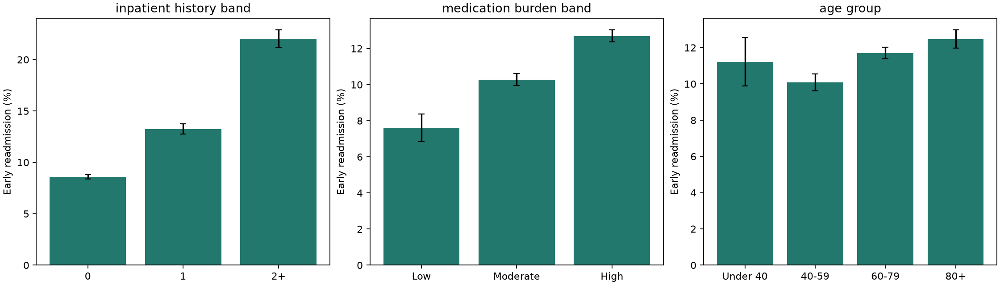
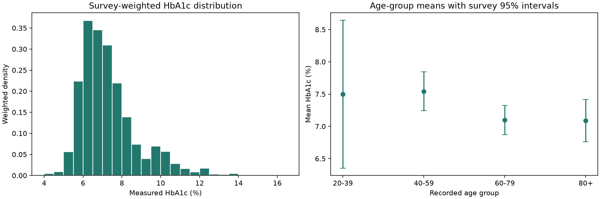
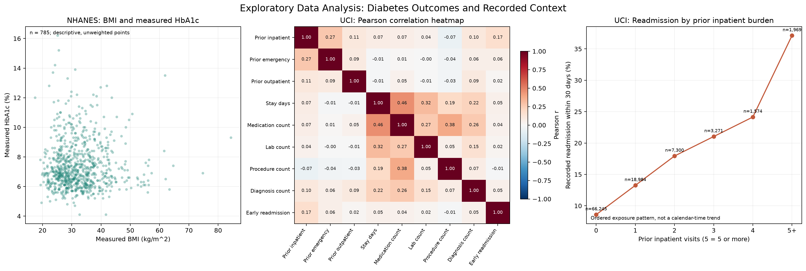

# Chronic Disease Management Analytics

## A Two-Study Analysis of Hospital Readmission and Glycemic Status

**Subject:** Data Science & Analytics  
**Theme:** Healthcare Analytics  
**Project team:** Aaditya Shirke (23610074), Aditi Mittal (23610067), Arth Rai (23510076), Avinash Waykule (23610078), Pranav Gujar (23510038)  
**Institution:** Walchand College of Engineering, Sangli  
**Department:** Information Technology  
**Class/discipline:** FinTech MDM Data Science  
**Faculty guide:** [Faculty name]  
**Academic year:** [Academic year]  
**Submission date:** [Date]

---

## Certificate

This is to certify that the project titled **“Chronic Disease Management Analytics: A Two-Study Analysis of Hospital Readmission and Glycemic Status”** has been prepared by **[student name(s), roll number(s)]** in partial fulfillment of the requirements for **[course/programme]** during **[academic year]**, under the guidance of **[faculty guide]**.

The work presented here is based on the sources cited in this report. Any institutional certification, signatures, or required declarations should be completed and approved by the student and faculty before submission.

| Role | Name and signature | Date |
| --- | --- | --- |
| Student(s) | [Complete] | [Date] |
| Faculty guide | [Complete] | [Date] |
| Head of department | [If required] | [Date] |

---

## Acknowledgement

I/we thank **[faculty guide]** for guidance on the project and **[department/institution]** for the opportunity to complete it. I/we also acknowledge the University of California, Irvine Machine Learning Repository and the U.S. National Center for Health Statistics for making the source datasets and documentation available. The findings and interpretations in this report are the responsibility of the project authors.

**[Personalize this section before submission.]**

---

## Executive Summary

Diabetes management spans care during hospitalization, discharge and follow-up, ongoing treatment, and monitoring of glycemic status. This project asks what two public datasets can show about those contexts without treating statistical associations as causes. It conducts two separate observational studies: the UCI Diabetes 130-US Hospitals dataset is used to examine recorded 30-day readmission among hospital encounters; NHANES 2017-2018 is used to estimate measured HbA1c and study its associations with reported characteristics among adults with diagnosed diabetes.

After excluding 2,423 expired/hospice discharge encounters under a documented study-scope rule, the UCI analysis includes 99,343 encounters from 69,990 patients. Early readmission occurred in 11.39% of encounters. The rate increased across prior inpatient-use groups, from 8.59% with no recorded prior inpatient visits to 22.02% with two or more. In the adjusted patient-clustered model, each additional prior inpatient visit was associated with 1.309 times the odds of early readmission (95% CI 1.292-1.327). Exploratory held-out model performance was modest: the best tested model had ROC-AUC 0.668 and average precision 0.226.

The NHANES measured-HbA1c domain includes 804 adults. Its survey-weighted mean HbA1c was 7.28% (95% interval 7.12%-7.44%); the weighted proportion at or above 8% was 23.18% (19.51%-27.32%). The initial adjusted model used 651 complete cases and had five residual survey degrees of freedom. Reported insulin and diabetic-pill use had positive adjusted associations with HbA1c, but treatment selection, illness burden, and cross-sectional measurement prevent a medication-effect interpretation.

The studies are complementary, not linkable or directly comparable. They support exploratory research and careful prioritization of future validation. They do not establish preventability, causal treatment effects, a deployable risk score, or clinical utility.

---

## Contents

1. Problem Statement and Objectives  
2. Healthcare Background and Literature Review  
3. Data Collection and Study Design  
4. Data Cleaning and Feature Preparation  
5. Exploratory Data Analysis  
6. Analytical Methods  
7. Results and Insights  
8. Business and Operational Recommendations  
9. Limitations and Future Scope  
10. Conclusion  
11. References  
12. Appendix

---

## 1. Problem Statement and Objectives

### 1.1 Problem statement

Healthcare organizations need to understand which recorded patient and care-context characteristics are associated with important diabetes-related outcomes. Hospital readmission is relevant to utilization and transition-of-care planning, while HbA1c is a laboratory measure of glycemic status. Each outcome captures a different part of the care problem. Neither, on its own, establishes that a patient has received poor care or that a particular intervention will improve outcomes.

This project uses available secondary data to answer two bounded questions:

1. Among eligible encounters in the UCI Diabetes 130-US Hospitals data, which recorded clinical, treatment, utilization, and discharge characteristics are associated with recorded readmission within 30 days, and how well do selected models rank that outcome at discharge?
2. Among NHANES 2017-2018 adults reporting diagnosed diabetes and having measured HbA1c, how do selected socioeconomic, activity, treatment, and monitoring characteristics relate to measured HbA1c when the complex survey design is accounted for?

These are observational questions. The analyses estimate associations and exploratory prediction, not intervention effects.

### 1.2 Objectives

- Document the population, source, fields, missingness, and cleaning decisions for each dataset.
- Describe readmission and HbA1c outcomes with appropriate cohort and survey-design methods.
- Estimate adjusted associations using patient-clustered uncertainty for UCI and complex-survey inference for NHANES.
- Evaluate exploratory UCI prediction on a patient-separated holdout and test selected robustness scenarios.
- Summarize actionable research implications while identifying what evidence is still required before operational use.

### 1.3 Scope and exclusions

UCI and NHANES contain different people, periods, sampling designs, and outcomes. There is no shared participant identifier. No record linkage, pooled effect, or external validation of the UCI model using NHANES is attempted. UCI prediction is a discharge-time exploratory analysis, not admission-time triage. NHANES is a cross-sectional analysis of HbA1c measured at the examination, not a forecast of later clinical events.

---

## 2. Healthcare Background and Literature Review

### 2.1 Chronic disease management and diabetes

Diabetes is a major public-health and healthcare-delivery issue. The Centers for Disease Control and Prevention's National Diabetes Statistics Report summarizes U.S. prevalence, incidence, complications, mortality, and costs; its current summary estimates 40.1 million people had diagnosed or undiagnosed diabetes in 2023 [1]. That scale motivates analysis of both clinical outcomes and healthcare-use patterns, but population-level burden does not imply that a single administrative dataset can measure the quality of an individual's management.

Diabetes care involves multiple processes: monitoring glycemia, selecting and adjusting treatment, managing comorbidities, supporting self-management, and maintaining continuity across care settings. A hospital encounter captures only part of this process. Administrative fields such as prior admissions, medication records, and discharge disposition can provide useful context, but do not directly observe medication adherence, outpatient follow-up quality, social support, or all elements of disease severity. This distinction is important when interpreting model predictors as possible operational signals rather than as explanations of why an outcome occurred.

HbA1c provides a complementary clinical measure. The American Diabetes Association's Standards of Care describe HbA1c as reflecting glycemic exposure over approximately the preceding two to three months, while noting that clinical interpretation depends on context and factors that affect the relationship between HbA1c and glycemia [2]. A population mean or fixed threshold is therefore not an individualized treatment target. This project reports HbA1c as a continuous examination measure and uses >=8% and >=7% only as secondary analytical thresholds, not as universal definitions of success or failure.

### 2.2 Readmission as a healthcare-utilization outcome

Hospital readmission is studied as an indicator of subsequent hospital use and a possible signal for quality-improvement research. It is not a direct measure of avoidability: returns can reflect illness burden, planned care, incomplete capture across institutions, or other factors. The Agency for Healthcare Research and Quality's HCUP program describes readmission databases as resources for examining readmission patterns, while emphasizing the need for data suitable to the question [3]. The UCI source data provide encounter-level records but not the hospital and calendar-time structure needed for hospital-separated or temporal validation in this project.

The UCI Diabetes 130-US Hospitals data cover 1999-2008 and were created from inpatient encounters at 130 U.S. hospitals and integrated delivery networks. The associated research article by Strack and colleagues examined HbA1c measurement and readmission in a large clinical database [4]. The current project reuses the public dataset for a documented exploratory workflow; it does not claim exact replication of the original article's model because the precise original code and regression specification are unavailable. The project's separate PDF review records numerical comparisons and interpretation corrections.

Prior utilization is a plausible candidate signal for future readmission research because it summarizes recent acute-care use. However, a high predictive ranking does not show that reducing prior visits would reduce future readmission. It may instead mark persistent illness burden or other unmeasured context. Patient-level grouping is essential in evaluation because repeated encounters from the same person are statistically dependent and must not be split across training and test sets when the goal is new-patient evaluation.

### 2.3 Population measurement and survey inference

NHANES combines interviews, examinations, and laboratory measurements in a complex multistage probability sample of the civilian, noninstitutionalized U.S. population. The National Center for Health Statistics provides sample-design documentation and tutorials on selecting appropriate weights, strata, primary sampling units (PSUs), variance estimation, and domain analysis [5]. These features are not optional decoration: estimates that ignore the survey design can have misleading uncertainty and representation.

This project uses the 2017-2018 cycle because it contains the measured HbA1c, demographics/design fields, diabetes monitoring questions, body measures, activity, and healthcare-access information required for a coherent first-pass study. NHANES measures a broad survey universe; the project defines a smaller adult diagnosed-diabetes domain. The domain is not a longitudinal cohort, and measures from one examination cycle cannot establish temporal direction. The initial model's limited residual survey degrees of freedom are disclosed because a large participant count alone does not guarantee precise design-based inference.

### 2.4 Why the studies are complementary but separate

UCI contributes historical hospital encounter and discharge context, with repeated records per patient and a recorded readmission label. NHANES contributes a contemporary-for-its-cycle population survey context and laboratory HbA1c, along with reported treatment, monitoring, and activity. These sources answer different questions. Their joint value is conceptual: one illustrates utilization after hospitalization, and the other describes a measured glycemic outcome in a survey domain. Their coefficients, metrics, populations, and outcomes cannot be pooled or ranked against one another.

---

## 3. Data Collection and Study Design

### 3.1 Secondary-data collection

No new patient survey was conducted. The project follows the guideline's permitted secondary-data route using a public UCI dataset and official CDC/NCHS NHANES component files. UCI raw files are retained unchanged locally. NHANES acquisition downloads six official component files and their codebooks when absent, validates participant identifiers, and merges components to the demographic universe. Source inventories and hashes are documented in the study reports. Raw and large patient-level files are ignored by Git and must be downloaded/restored when setting up a fresh clone.

### 3.2 Study populations and outcomes

| Study | Source population and analytic unit | Analysis population | Outcome |
| --- | --- | --- | --- |
| UCI | Diabetes-related hospital encounters, 1999-2008; repeated encounters per patient | 99,343 eligible encounters from 69,990 patients, after documented expired/hospice exclusions | Recorded readmission within 30 days (`<30`) |
| NHANES | 2017-2018 civilian noninstitutionalized survey participants; participant-level | 804 adults aged 20+ reporting diagnosed diabetes, with measured HbA1c and usable MEC survey design | Continuous HbA1c (`LBXGH`, percent); secondary >=8% and >=7% flags |

The UCI raw file contains 101,766 encounters and 71,518 unique patients. The NHANES demographic universe contains 9,254 participants; 5,569 are age 20+, 876 report diagnosed diabetes, 804 meet the primary measured-HbA1c domain, and 651 are complete cases in the initial adjusted model. The NHANES primary domain excludes known pregnancy, requires a positive MEC examination weight and available stratum/PSU fields, and does not reliably distinguish type 1 from type 2 diabetes.

### 3.3 Variables and analytical roles

UCI fields include prior inpatient/emergency/outpatient visits, age bands, diagnoses, procedures, length of stay, medication fields, laboratory-result categories, and admission/discharge context. Patient and encounter identifiers are retained for grouping and audit but excluded from predictors. Outcome labels are never predictors.

NHANES fields include age, recorded sex, measured BMI, income-to-poverty ratio, education, reported insulin and pill use, usual diabetes professional, A1C testing, glucose-check frequency, activity, HbA1c, and the survey design variables. Weights, strata, PSUs, IDs, outcome-derived flags, and data-quality/domain flags are not treated as clinical predictors. The feature table's column count is not a count of independent predictors.

---

## 4. Data Cleaning and Feature Preparation

### 4.1 Audit and cleaning summary

| Check | UCI | NHANES |
| --- | --- | --- |
| Duplicate and identity checks | No duplicate encounter IDs or exact duplicate rows; repeated patients are retained because encounters are not duplicates. | Component joins are checked by unique participant identifier SEQN; the full demographic universe is retained for design-based domains. |
| Missingness | Weight is 96.86% missing; medical specialty 49.08%; payer 39.56%; race 2.23%; diagnosis fields have lower missingness. | Field-specific response categories and missing reasons are preserved, including refusal, don't know, structural skips, release restrictions, missing units, and unavailable measurements. |
| Invalid values and formatting | Counts are checked as numeric fields; no invalid integers or negative values were found in the audited count fields. Administrative IDs are treated as categorical codes, not ordered quantities. | Special codes, SAS transport parsing, units, and module-specific variable meanings are reviewed against official documentation. A verified exact SAS-zero parsing artifact is corrected at acquisition without changing source XPT files. |
| Outliers and top-coding | Extreme prior utilization values are retained rather than automatically deleted. Sensitivity analyses include log-transformed utilization. | NHANES age 80+ and income-to-poverty ratio 5+ are top-coded in the selected variables. These values are not interpreted as exact values above the release limits. |
| Cohort exclusions | Exclude 2,423 encounters with expired/hospice discharge codes 11, 13, 14, 19, 20, and 21. This defines study scope; it is not a claim that hospice patients cannot return. | Primary domain applies adult, diagnosed-diabetes, measured-HbA1c, pregnancy, positive MEC weight, and design-field rules. A pregnancy-uncertainty sensitivity domain excludes two additional participants. |
| Missing-value treatment | Mostly missing weight and constant `examide`/`citoglipton` fields are dropped; unknown/invalid categories remain explicit. Lab `None` means no result recorded, not a normal result. | No blanket blank-to-zero rule or clinical imputation is used. Genuine zeros remain zeros; absent activity or monitoring values are not fabricated. |

### 4.2 Cleaning outputs and transformations

The UCI cleaned cohort has 47 columns; adding 15 derived fields produces a 62-column feature table. There are 16,341 patients with multiple retained encounters; these repeats are kept and handled through patient-clustered inference and patient-separated prediction. Derived fields include the binary early-readmission target, utilization summaries, diagnosis groups, age groups, medication burden, and separate general-regimen-change and explicit dose-change indicators. The primary adjusted association model and expanded prediction models use prespecified predictor sets rather than every stored field.

The NHANES cleaned table retains 9,254 rows, selected source fields, and domain/status indicators so the survey design is not lost by filtering to the 804-person analysis domain. Its selected 52 columns (49 fields plus status/domain flags) are expanded with 27 derived variables. These include unit-aware glucose-check frequency, activity summaries, treatment/monitoring indicators, categories, and secondary outcome flags. The final feature table contains 79 columns, not 79 independent predictors.

The UCI general regimen-change flag is distinct from any explicit drug dose Up/Down field: 19,102 retained encounters have a recorded `Ch` value without an explicit dose-change value. The two representations are not interchangeable.

There is no blanket normalization of stored source data. That preserves source units and interpretability. Where scaling or transformations are analytically useful, they are explicit: the expanded UCI logistic pipeline fits preprocessing on training patients only; NHANES model terms use interpretable scaling such as age per 10 years and BMI per 5 units, with log transformations for skewed activity and glucose-check quantities. These are model-specification choices, not universal data-cleaning rules.

---

## 5. Exploratory Data Analysis

### 5.1 Distribution and group comparisons

The UCI bar charts show early-readmission rates by prior inpatient-use band, medication burden, and age group. The prior inpatient pattern is the clearest descriptive gradient. The NHANES HbA1c figure includes a survey-weighted outcome distribution and weighted age-group means with survey intervals. These describe distributions and group differences; they are not causal comparisons.





### 5.2 Scatter, correlation, and ordered trend views

The following exploratory figure adds the remaining suitable visual forms: a scatter plot of BMI against HbA1c in NHANES, a Pearson correlation heatmap of selected numeric UCI fields, and an ordered line plot of UCI readmission by prior inpatient-use category.



The BMI-HbA1c scatter contains 785 domain participants with nonmissing BMI and HbA1c. It is an unweighted visualization; it does not replace the survey-weighted estimates. The Pearson heatmap is an unadjusted descriptive summary and does not establish cause or independence. Its strongest association with early readmission among the displayed numeric fields is prior inpatient count (r=0.17); the other displayed pairwise correlations with the outcome are small. Correlation is not model feature importance.

The line plot is a trend across **ordered prior-use categories**, not a calendar-time trend. The UCI file has no usable encounter timestamps for temporal validation, and NHANES is one cross-sectional cycle. Therefore, the project cannot estimate changes in readmission or HbA1c over calendar time. The available bar, histogram, scatter, heatmap, line, and pivot views satisfy the suitable descriptive forms without inventing a time series.

### 5.3 Pivot table: UCI prior inpatient history by recorded outcome

| Prior inpatient visits | Readmitted <30 days | Readmitted >30 days | No recorded readmission | Total encounters | Early-readmission rate |
| --- | ---: | ---: | ---: | ---: | ---: |
| 0 | 5,690 | 20,307 | 40,248 | 66,245 | 8.59% |
| 1 | 2,516 | 8,155 | 8,313 | 18,984 | 13.25% |
| 2+ | 3,108 | 7,040 | 3,966 | 14,114 | 22.02% |
| **Total** | **11,314** | **35,502** | **52,527** | **99,343** | **11.39%** |

This cross-tab is encounter-weighted and descriptive. Patients with repeated encounters contribute more than one row; patient-clustered intervals and regression are used for inferential analysis.

### 5.4 Survey-weighted NHANES group summary

| Reported insulin use | Unweighted participants | Survey-weighted mean HbA1c | Survey 95% interval |
| --- | ---: | ---: | ---: |
| No | 577 | 7.00% | 6.80%-7.20% |
| Yes | 227 | 8.02% | 7.78%-8.27% |

This table is descriptive, not a formal between-group test or treatment effect. The age/severity mix and treatment selection differ between groups; the adjusted survey model and its limitations are presented below.

---

## 6. Analytical Methods

### 6.1 UCI readmission analysis

The binary target equals one for the source label `<30`, and zero for `>30` or `NO`. Full-cohort rates use patient-clustered uncertainty. Exploratory chi-square and Mann-Whitney tests use one seed-42 randomly selected encounter per patient so those tests do not treat a person's repeated encounters as independent. Sparse chi-square comparisons are flagged, and Benjamini-Hochberg false-discovery-rate (FDR) adjustments are applied to defined test families.

Selected exploratory results from the one-encounter-per-patient sample are shown below. These tests identify distributional differences; their small p-values do not establish large effects or causes.

| Variable | Test | Statistic | FDR-adjusted p-value |
| --- | --- | ---: | ---: |
| Prior inpatient history band | Chi-square (df=2) | 1,246.1 | 4.47e-270 |
| Age group | Chi-square (df=3) | 165.9 | 2.78e-35 |
| Medication burden band | Chi-square (df=2) | 148.3 | 1.36e-32 |
| Insulin category | Chi-square (df=3) | 75.2 | 5.65e-16 |
| Any explicit drug dose change | Chi-square (df=1) | 27.2 | 2.58e-7 |
| General medication-change flag | Chi-square (df=1) | 19.4 | 1.29e-5 |
| A1C result category | Chi-square (df=3) | 16.5 | 0.00101 |
| Prior inpatient visit count | Mann-Whitney U | 202,110,087.5 | 5.05e-236 |
| Number of procedures | Mann-Whitney U | 170,948,117 | 0.214 |

Gender and primary diagnosis-group chi-square p-values were withheld because expected cells were sparse. Mann-Whitney tests compare distributions and are not automatically tests of median differences.

The prespecified logistic regression uses patient-clustered standard errors and whole-term Wald tests. Its predictors include prior utilization, medication and diagnosis counts, length of stay, selected age/race/diagnosis/insulin/lab categories, and a general medication-change indicator. The model estimates adjusted associations, not causal effects.

Prediction comparisons use a patient-separated holdout: training has 55,992 patients and 79,522 encounters; evaluation has 13,998 patients and 19,821 encounters, with zero patient overlap. The expanded logistic and histogram-gradient-boosting models share 22 selected inputs. Encoders/scalers are fit on training patients only. Model comparisons, patient bootstrap, permutation importance, subgroup summaries, and sensitivity models are documented in the UCI validation report. Because the same evaluation set was examined during earlier stages, these results are exploratory internal evaluation, not a fresh final test.

### 6.2 NHANES survey analysis

The NHANES study uses MEC examination weights (`WTMEC2YR`) with strata (`SDMVSTRA`) and PSUs (`SDMVPSU`). The full design contains 15 strata and 30 stratum-PSU pairs. The full 9,254-person design is retained; analysis domains are selected within the survey design rather than treating the 804-person subset as a simple random sample. Taylor-linearized uncertainty is used for weighted means, proportions, and Gaussian regression. The study does not apply an additional HbA1c item-nonresponse adjustment.

The initial adjusted Gaussian model has ten fixed slopes: age per ten years, recorded female category, BMI per five units, income-to-poverty ratio, insulin, diabetic pill use, usual diabetes professional, past-year A1C test, log-transformed daily-equivalent glucose checks, and log-transformed weekly moderate-equivalent activity. No outcome-driven feature selection or learned imputation is used. Ten coefficient tests are FDR-adjusted with the intercept excluded.

### 6.3 Interpretation rules

- Odds ratios are interpreted as odds, not equivalent changes in probability.
- HbA1c coefficients are percentage-point differences, not relative percentages.
- Statistical association, predictive importance, and intervention effect are different claims.
- UCI encounter-level rates are not directly comparable with NHANES survey-weighted estimates.
- No participant-level relationship is drawn between UCI and NHANES.

---

## 7. Results and Insights

### 7.1 UCI: recorded early readmission

Early readmission occurred in 11,314 of 99,343 eligible encounters (11.39%). The descriptive rate increased from 8.59% among encounters with no prior inpatient visits to 13.25% with one and 22.02% with two or more. This gradient is consistent with prior acute-care use being an informative marker of future utilization, while not specifying the mechanism behind it.

In the primary adjusted logistic model, each additional prior inpatient visit was associated with an adjusted odds ratio of **1.309** (patient-clustered 95% CI 1.292-1.327). This means 30.9% higher adjusted odds per additional recorded visit under this model, not a 30.9% increase in probability. Prior emergency visits, diagnosis count, length of stay, and medication count also have adjusted associations in the primary model; their estimates and complete intervals are in the linked analysis outputs.

| Adjusted term | Odds ratio | Patient-clustered 95% CI | Interpretation |
| --- | ---: | --- | --- |
| Prior inpatient visits, per visit | 1.309 | 1.292-1.327 | Higher adjusted odds per additional recorded visit |
| Prior emergency visits, per visit | 1.035 | 1.009-1.061 | Small positive association |
| Diagnosis count, per diagnosis | 1.048 | 1.036-1.061 | Small positive association |
| Length of stay, per day | 1.023 | 1.016-1.031 | Small positive association |
| Age 80+ versus under 40 | 1.259 | 1.131-1.401 | Adjusted association relative to reference age group |
| Insulin category Down versus No | 1.325 | 1.225-1.433 | Recorded treatment category; not an effect of reducing insulin |
| General medication-change flag | 0.941 | 0.891-0.994 | Specification-sensitive; not evidence of protection |

The medication-change flag is not identical to an explicit drug dose change, as described in Section 4.2. The age and insulin-category contrasts describe adjusted associations and should not be converted into treatment directives.

| UCI model | ROC-AUC | Average precision | Brier score |
| --- | ---: | ---: | ---: |
| Initial logistic | 0.626 | 0.189 | 0.0965 |
| Constant-risk baseline | 0.500 | 0.111 | 0.0990 |
| Expanded logistic | 0.657 | 0.213 | 0.0951 |
| Histogram gradient boosting | 0.668 | 0.226 | 0.0942 |

The held-out event prevalence was approximately 0.111. Average precision should be considered relative to that prevalence. Gradient boosting performed best among the tested models, but its discrimination is modest and does not establish a clinically useful threshold. Prior inpatient use and discharge disposition led the tested permutation rankings. Permutation rankings are model-specific and should not be read as causal importance.

The medication-change association was sensitive to specification. Its primary adjusted OR was 0.941, but the interval included one in the one-encounter-per-patient and expanded-adjustment scenarios. The project therefore does not characterize medication changes as protective.

| UCI sensitivity scenario | Prior inpatient OR | Medication-change OR (95% CI) |
| --- | ---: | --- |
| Baseline | 1.309 | 0.941 (0.891-0.994) |
| One encounter per patient | 1.461 | 0.996 (0.925-1.073) |
| Log-transformed prior utilization | 2.068* | 0.940 (0.890-0.994) |
| Expanded adjustment | 1.305 | 0.950 (0.899-1.004) |
| Hospice included, recorded deaths excluded | 1.308 | 0.942 (0.892-0.995) |

*The log-utilization estimate is per unit increase in log(1 + visits), not per additional visit, and is not directly comparable with the other prior-inpatient odds ratios. Prior inpatient use remains positively associated across these scenarios; medication-change evidence is less stable.

### 7.2 NHANES: measured HbA1c

The 804-person measured-HbA1c domain had a survey-weighted mean of **7.28%** (95% interval 7.12%-7.44%). The weighted share with HbA1c >=8% was **23.18%** (19.51%-27.32%); the >=7% sensitivity share was 49.62% (41.96%-57.30%). These estimates use MEC weights and survey design, but no extra item-nonresponse adjustment. They describe the selected domain and are not personalized treatment targets.

| Adjusted model term | HbA1c percentage-point estimate | Survey 95% interval | FDR-adjusted p |
| --- | ---: | --- | ---: |
| Insulin use versus no use | 1.136 | 0.579 to 1.693 | 0.028 |
| Diabetic pill use versus no use | 0.595 | 0.266 to 0.925 | 0.028 |
| Income-to-poverty ratio, per unit | -0.130 | -0.242 to -0.018 | 0.102 |
| Age, per ten recorded years | -0.173 | -0.336 to -0.010 | 0.103 |
| Past-year A1C test versus no test | -0.258 | -0.724 to 0.208 | 0.356 |

The initial model used 651 complete cases, excluding 153 domain participants for at least one missing predictor. It has only five residual survey degrees of freedom. Positive treatment coefficients are plausibly influenced by treatment selection, disease severity or duration, and reverse causation; they do not show medication harm. Age and income directions are negative, but FDR-adjusted evidence is specification-sensitive.

Across the reference and five Gaussian sensitivity fits, insulin-use coefficients ranged from 1.008 to 1.196 HbA1c percentage points and diabetic-pill coefficients from 0.546 to 0.605; both remained positive with within-model FDR-adjusted p-values below 0.05 in all six fits. Age and income directions remained negative, but FDR evidence was below 0.05 in only two of six and two of five applicable fits, respectively. These are correlated sensitivity analyses, not independent replications.

Of 836 eligible examined adults reporting diagnosed diabetes and having positive MEC weights, 804 had measured HbA1c and 32 did not. Weighted HbA1c response coverage was 97.65% (Taylor 95% interval 96.49%-98.82%). This is a coverage estimate, not a nonresponse correction or proof that missingness is ignorable.

### 7.3 Integrated insight

Both datasets show that recorded treatment and healthcare-use context can carry information about observed outcomes. Their measures represent different constructs: UCI prior utilization and discharge destination are encounter-level administrative markers; NHANES treatment and monitoring are participant-reported context alongside a measured laboratory outcome. The results support better data collection and stronger validation, not a shared causal pathway or combined patient score.

---

## 8. Business and Operational Recommendations

These recommendations are for healthcare analytics and quality-improvement planning. They are proposals to evaluate, not interventions proven by this project.

1. **Prioritize validation of prior-use indicators.** A future readmission-focused study could evaluate prior inpatient history as a candidate signal for post-discharge review or case-management outreach. Before use, test calibration, sensitivity, positive predictive value, and workload at prespecified thresholds in a newer, independent cohort.
2. **Evaluate, rather than mandate, transition workflows.** Pharmacy medication reconciliation for complex medication lists and coordinated follow-up for older or multimorbid patients are reasonable candidates for prospective evaluation. Do not use discharge destination as a substitute for follow-up completion or care quality; collect referral, appointment scheduling and completion, reconciliation, and post-discharge contact measures directly.
3. **Do not change medication based on these associations.** The UCI medication-change result is specification-sensitive, and NHANES treatment associations are vulnerable to confounding by disease burden and treatment selection. Clinical treatment remains a clinician-patient decision based on appropriate evidence and individual context.
4. **Evaluate a workflow before deploying a score.** If a future model is tested, assess calibration, clinical utility, false-positive workload, cost, subgroup uncertainty, and patient impact. Conduct prospective evaluation with clinical oversight; do not treat this report's holdout as deployment validation.
5. **Improve follow-up research on glycemic management.** Use repeat measurements and richer clinical history to examine HbA1c trajectories, duration/severity, treatment timing, and response. Any additional NHANES cycles should be pooled only after comparability and weight construction are verified.
6. **Build safeguards into any future decision support.** Do not allocate care using race as a biological explanation or treat subgroup differences as fairness evidence. Review performance and uncertainty across relevant subgroups and involve clinicians and affected communities in governance.

---

## 9. Limitations and Future Scope

### 9.1 Data and measurement limitations

UCI represents historical U.S. hospital encounters from 1999-2008. It lacks usable calendar timestamps and a hospital identifier for temporal or hospital-held-out validation. Its readmission label is a recorded return in the source data, not necessarily a diabetes-related, avoidable, or complete all-system event. Lifestyle, adherence, outpatient continuity, and several social factors are not directly measured. Repeated encounters and selection rules affect the analytic population.

NHANES is cross-sectional and uses one 2017-2018 cycle. The diagnosed-diabetes domain is self-reported and does not reliably distinguish diabetes type. HbA1c response and predictor missingness may introduce selection; the initial model is complete-case and has only five residual survey degrees of freedom. The survey design supports appropriate variance estimation but cannot remove unmeasured confounding or item nonresponse. Top-coded values, unit conversions, and derived activity measures are documented but remain measurement constraints.

### 9.2 Inferential and prediction limitations

Neither study is randomized. Adjusted regression cannot eliminate unmeasured confounding or reverse causation. UCI bootstrap intervals condition on fitted models and do not capture full training/model-selection variation. Permutation importance can be affected by correlated inputs and implausible feature combinations. UCI subgroup metrics are exploratory point estimates and are not fairness certification. NHANES is not a prediction study and has no held-out performance evaluation. No validated clinical threshold or decision-support system is produced.

### 9.3 Future research

- Seek newer, independent encounter data with consistent outcomes and dates for temporal and external validation.
- Collect direct measures of follow-up, care continuity, adherence, severity, and treatment timing.
- Assess model stability with grouped cross-validation or repeated patient-separated splits before selecting a final model.
- Evaluate additional NHANES cycles only after checking variable comparability, survey weights, and domain definitions.
- State and test missing-data assumptions; evaluate additional response adjustment where methodologically justified.
- Pre-register any predictive or clinical-utility study with thresholds, evaluation metrics, subgroup analyses, and implementation outcomes defined in advance.

---

## 10. Conclusion

This project develops two complementary, separate analyses of diabetes-related outcomes. In the UCI encounter cohort, prior inpatient use is strongly associated with recorded 30-day readmission and is the leading tested predictive input, while overall model performance remains modest. In NHANES, survey-weighted HbA1c estimates and adjusted associations describe a measured adult diabetes domain, but missingness, cross-sectional design, and low residual survey degrees of freedom limit inference.

The analyses provide useful exploratory insights for future healthcare research: improve direct measurement of transition processes, validate candidate utilization signals in independent populations, and interpret treatment associations in light of confounding and selection. They do not establish that readmissions are preventable, that any treatment caused the observed HbA1c differences, or that a risk score should be deployed. Responsible next steps are better data, stronger independent validation, and prospective evaluation under clinical governance.

---

## 11. References

1. Centers for Disease Control and Prevention. **National Diabetes Statistics Report**. Current online report; prevalence estimates summarized for 2023. Available at: [https://www.cdc.gov/diabetes/php/data-research/index.html](https://www.cdc.gov/diabetes/php/data-research/index.html). Accessed 16 October 2026.
2. American Diabetes Association Professional Practice Committee. 2. Diagnosis and classification of diabetes: Standards of Care in Diabetes—2025. *Diabetes Care*. 2025;48(Suppl. 1):S27-S49. doi:[10.2337/dc25-S002](https://doi.org/10.2337/dc25-S002).
3. Agency for Healthcare Research and Quality. **Healthcare Cost and Utilization Project (HCUP)**. Available at: [https://www.ahrq.gov/data/hcup/index.html](https://www.ahrq.gov/data/hcup/index.html). Accessed 16 October 2026.
4. Clore J, Cios K, DeShazo J, Strack B. **Diabetes 130-US Hospitals for Years 1999-2008** [dataset]. UCI Machine Learning Repository. 2014. doi:[10.24432/C5230J](https://doi.org/10.24432/C5230J).
5. National Center for Health Statistics. **NHANES Tutorials: Sample Design, Weighting, and Variance Estimation**. Available at: [https://wwwn.cdc.gov/nchs/nhanes/tutorials/](https://wwwn.cdc.gov/nchs/nhanes/tutorials/). Accessed 16 October 2026.
6. National Center for Health Statistics. **National Health and Nutrition Examination Survey, 2017-2018: Questionnaires, Datasets, and Documentation**. Available at: [https://wwwn.cdc.gov/nchs/nhanes/continuousnhanes/default.aspx?BeginYear=2017](https://wwwn.cdc.gov/nchs/nhanes/continuousnhanes/default.aspx?BeginYear=2017). Accessed 16 October 2026.
7. Strack B, DeShazo JP, Gennings C, et al. Impact of HbA1c measurement on hospital readmission rates: analysis of 70,000 clinical database patient records. *BioMed Research International*. 2014;2014:781670. doi:[10.1155/2014/781670](https://doi.org/10.1155/2014/781670).
8. **DS&A Project Guidelines**. Course-provided PDF in this repository. Stages 1-9 and suggested report structure.

---

## 12. Appendix

### A. Study workflow and reproducibility

The project uses separate dataset workflows. UCI has a single runner that executes method regression checks and five analytical stages in sequence, verifies raw-file fingerprints, and records a run result. The latest saved successful run record reviewed for this report is dated 9 October 2026. NHANES acquisition, audit, cleaning, feature extraction, outcome analysis, and robustness are run as separate scripts, with focused unit tests documented in its project guide. This report reflects saved project outputs; rerun workflows and checks after any data, method, or code change.

From the repository root, the documented workflow entry points are:

```powershell
python datasets/uci/run_pipeline.py
python datasets/nhanes/scripts/00_data_acquisition/download_data.py
python datasets/nhanes/scripts/01_data_audit/data_audit.py
python datasets/nhanes/scripts/02_data_cleaning/data_cleaning.py
python datasets/nhanes/scripts/03_feature_extraction/feature_extraction.py
python datasets/nhanes/scripts/04_outcome_analysis/outcome_analysis.py
python datasets/nhanes/scripts/05_robustness_validation/robustness_validation.py
```

### B. Selected glossary

| Term | Meaning in this report |
| --- | --- |
| Encounter | One UCI hospital record; an individual patient may contribute multiple encounters. |
| Early readmission | UCI source label `<30`, converted to a binary outcome for analysis. |
| MEC weight | NHANES mobile examination center weight, used for measured examination outcomes such as HbA1c. |
| PSU / stratum | NHANES sample-design fields used with survey weights for variance estimation. |
| Odds ratio | Relative odds associated with a model term; it is not a probability ratio. |
| FDR | False-discovery-rate adjustment applied to a specified family of statistical tests. |
| Average precision | Precision-recall summary; compare it with event prevalence for context. |

### C. Guideline coverage checklist

| Guideline deliverable | Location in this report |
| --- | --- |
| Business-oriented problem and objectives | Sections 1 and 8 |
| Industry/background research and sources | Sections 2 and 11 |
| Data source and collection description | Section 3 |
| Missing values, duplicates, outliers, formatting, scaling | Section 4 |
| Histograms and bar charts | Section 5 and linked study figures |
| Line graph and trend discussion | Section 5; ordered burden pattern, with calendar-time limitation stated |
| Scatter plot and correlation heatmap | Section 5, `guideline_eda.png` |
| Pivot tables | Section 5.3-5.4 |
| Analytics and hypothesis testing | Sections 6-7 |
| Insights, recommendations, limitations, future scope | Sections 7-9 |
| Executive summary, references, appendix | Front matter, Sections 11-12 |

### D. Project evidence files

- [Repository overview](../README.md)
- [UCI study guide](../datasets/uci/README.md)
- [UCI final research report](../datasets/uci/reports/06_final_report/README.md)
- [UCI outcome analysis](../datasets/uci/reports/04_outcome_analysis/README.md)
- [UCI robustness and prediction](../datasets/uci/reports/05_robustness_validation/README.md)
- [NHANES study guide](../datasets/nhanes/README.md)
- [NHANES final research report](../datasets/nhanes/reports/06_final_report/README.md)
- [NHANES survey-aware analysis](../datasets/nhanes/reports/04_outcome_analysis/README.md)
- [Cross-study synthesis](research_synthesis/README.md)