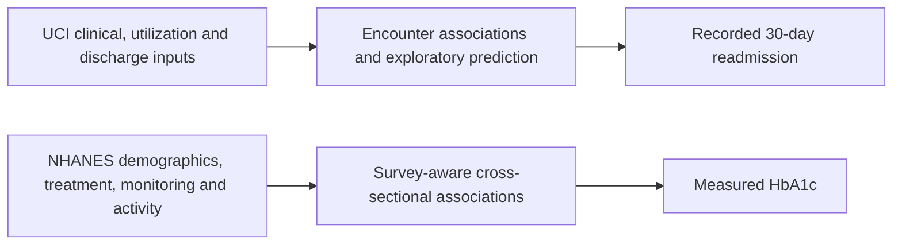

# Chronic Disease Management: Two Complementary Studies

## Project Question

What can recorded patient characteristics, treatment, healthcare utilization, monitoring, and
care context tell us about diabetes-related outcomes, and what remains unmeasured?

The project uses two separate observational studies. **UCI examines recorded early hospital readmission;
NHANES examines measured HbA1c.** Their complementary scope does not make them interchangeable datasets.

## Side-by-Side Design

| Dimension | UCI Diabetes 130-US Hospitals | NHANES 2017-2018 |
| --- | --- | --- |
| Unit | Hospital encounter; patients can repeat | Survey participant |
| Source population | Selected diabetes hospital records, 1999-2008 | U.S. civilian noninstitutionalized survey population; selected adult diabetes domain |
| Original universe | 101,766 encounters / 71,518 patients | 9,254 survey participants |
| Primary analysis | 99,343 encounters / 69,990 patients | 804 adults with reported diagnosis and measured HbA1c |
| Outcome | Recorded readmission within 30 days | Continuous measured HbA1c; secondary >=8% and >=7% flags |
| Statistical dependence | Repeated patient encounters | Stratification, unequal sampling weights, and PSU clustering |
| Main inference | Patient-clustered adjusted logistic associations | MEC-weighted Gaussian associations and Taylor survey variance |
| Predictive evaluation | Patient-separated exploratory holdout and permutation importance | Not performed |
| Initial adjusted-model sample | Primary eligible encounter cohort | 651 complete cases |
| Major gaps | Lifestyle, adherence, direct outpatient continuity | Temporal direction, severity/duration adjustment, outcome/predictor nonresponse |

NHANES is not a linked follow-up cohort for UCI. There is no shared patient identifier, no patient-level join,
and no valid way to fill one person's missing UCI lifestyle variables using another NHANES participant.
Differences in time period and selection further limit direct comparison.

## What UCI Supports

Early readmission occurs in **11.39%** of eligible encounters. The crude rate is **8.59%** with no
recorded prior inpatient visits and **22.02%** with two or more.
The primary adjusted odds ratio is **1.309 per additional prior inpatient visit**, not a 30.9% increase in probability.

Among the 22 tested predictive inputs, prior inpatient use and discharge disposition lead both expanded
model rankings. Gradient boosting has held-out ROC-AUC **0.668** and average precision **0.226**,
versus test prevalence approximately **0.111**. Absolute prediction remains modest, and the holdout was
examined across stages, so this is exploratory internal evaluation rather than untouched final validation.

The medication-change association is not consistent across sensitivity choices. Lower adjusted odds
must not be described as a proven protective treatment effect. Discharge destination does not establish
follow-up quality or whether a return was avoidable.

## What NHANES Supports

The primary domain has weighted mean HbA1c **7.28% (7.12% to 7.44%)** and weighted >=8% share
**23.18% (19.51% to 27.32%)**. These are examination-weighted measured-domain estimates without
additional item-nonresponse adjustment, not universal personalized goals or completely corrected national estimates.

The initial model uses **651 complete cases** and **five residual survey degrees of freedom**.
Reported insulin and pill use have positive HbA1c associations across tested Gaussian alternatives,
but treatment selection and disease burden prevent causal medication-harm conclusions.
Income and age evidence is more specification-sensitive after FDR adjustment.

NHANES supplies reported activity, monitoring, and usual-care information unavailable or less direct in UCI.
It still does not fully measure adherence, care quality, or treatment response over time.
No predictive-importance ranking or holdout performance has been computed for this study.

## What Can Be Compared

| Theme | Defensible comparison | What cannot be inferred |
| --- | --- | --- |
| Treatment | Recorded treatment helps describe patient context in each study | Medications cause adverse outcomes |
| Care context | UCI destination/utilization and NHANES usual-care/monitoring are different informative measures | A shared causal care-continuity mechanism was demonstrated |
| Disease burden | Hospital history and treatment intensity can reflect clinical complexity | They constitute the same validated severity index |
| Socioeconomic information | Each study contains limited, differently defined context | Payer code equals income or captures the same population construct |
| Outcomes | Readmission and HbA1c reflect different aspects of health | HbA1c threshold cases validate readmission predictions |
| Effect sizes | Interpret each estimate in its own units and population | Directly compare ORs, HbA1c percentage-point coefficients, and permutation drops |

Agreement in a broad theme is conceptual consistency, not replication of the same outcome or external validation.
Neither dataset identifies which clinical intervention will improve outcomes.

## Input, Channel, and Output

The diagrams describe analytical links. The hypothesized clinical channel includes illness burden,
management practices, and care transitions, but no mediation analysis or randomized intervention confirms
that pathway. Do not draw a measured patient-level arrow between the two study outcomes.

## Practical Research Implications

Prior hospital use and discharge context are useful candidates for future readmission-focused review.
NHANES supports studying management characteristics against a measured laboratory endpoint using the
survey design. Outreach, coordinated follow-up, or medication reconciliation are interventions to
evaluate separately, not interventions shown by these analyses to reduce readmission or HbA1c.

Any decision-support proposal requires clinical oversight, prospective/external evaluation, workload and
cost assessment, calibrated thresholds, and subgroup safeguards. No deployable patient risk score is validated.

## Project Status

Both dataset workflows have completed acquisition/understanding, cleaning, feature extraction,
initial outcome analysis, association robustness, and maintained research summaries. UCI additionally
has exploratory predictive comparisons. The project has not completed causal inference, external
validation, temporal validation, or clinical intervention evaluation.

For stronger research claims, address missingness assumptions, model stability, broader adjustment,
cross-cycle comparability, and independent validation with compatible outcomes. Keep each study's
population, sampling method, prediction timing, and outcome explicit.

## Detailed Evidence

- [UCI final research report](../../datasets/uci/reports/06_final_report/README.md)
- [UCI predictive robustness](../../datasets/uci/reports/05_robustness_validation/README.md)
- [NHANES final research report](../../datasets/nhanes/reports/06_final_report/README.md)
- [NHANES survey analysis](../../datasets/nhanes/reports/04_outcome_analysis/README.md)
- [NHANES robustness](../../datasets/nhanes/reports/05_robustness_validation/README.md)
- [Repository workflow](../../README.md)

This is a conceptual synthesis of separate analyses, not a pooled estimate or a merged dataset.